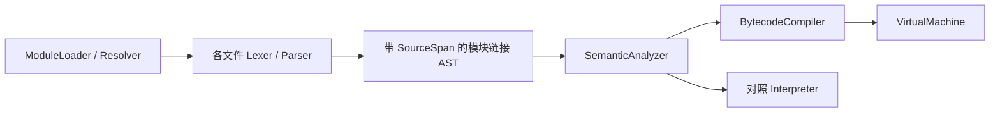
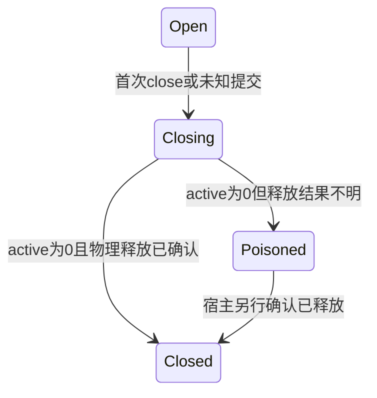

# 运行时与扩展设计

更新：2026-10-15。默认VM、解释器作对照；Native ABI1，HUAB普通6、Error/void7、File8，读取1–8。命令见 [开发指南](开发与运行指南.md)，std.*签名见 [接口参考](标准库与内建接口.md)。


<a id="a01-huab-preflight"></a>

## A01：未实现操作的加载前拒绝

新源码的unsafe/ref/ptr/取址在语义入口E3008拒绝；解析仍保留。为避免旧产物绕过源码检查，HUAB校验在所有代码块（含不可达指令）中拒绝默认Fail未实现操作、unsafe函数元数据及ref/ptr类型，加载E6002失败后不得初始化外接模块或执行前序输出/文件写入。抽象interface原型的既有Fail保留；携带明确诊断码的常量运算失败保留运行诊断语义。普通合法旧产物和Native ABI1保持兼容，版本布局未变：普通写6、Error/void7、File8，合法读1–8。此前只会执行到一半才失败的未开放操作产物不属于可执行基线。

本轮保留三份修复前实际生成、CRC及源码位置合法的HUAB6作为[反例数据](../tests/data/a01_unsupported_archives.json)，包含unsafe块、安全引用和unsafe函数，且前序有输出/文件写入。check/bytecode/run三个入口均在加载时拒绝，不产生副作用。其他运行时失败不一律变成加载错误；详见[能力表](设计决策与未决事项.md#a01-capability-audit)。


<a id="next-generation-runtime-boundaries"></a>

## 下一代运行时方向：复用E0的执行边界（2026-10-09）

这是新增规划，尚未对应新的Runtime类、std模块、权限系统或CLI。整体阶段与依赖只维护于 [统一实施规划](设计决策与未决事项.md#integrated-implementation-plan)，既有E0编号合同保持原文。

| 方向 | Runtime需要的共同信息与行为 | 保留边界 |
|---|---|---|
| HXE路径选择 | 模块/能力集合、目标与内部ABI、兼容缓存、编译/启动成本和选择原因；初始化前一次确定程序执行路径 | 当前默认栈VM不变；不支持路径执行前拒绝/选已有引擎，不能开始执行后换引擎重跑。 |
| Flow资源任务 | 逻辑Task身份、依赖、执行域、取消/截止、工作/内存/在途配额、输出和完成事件；统一接纳/释放责任 | 不重设公共Task类型；HHR提供资源/传输，AEE只规划合格计算。当前64/4096及快照隔离保持，任务优先级/共享移交API仍后置。 |
| Smart Memory | 类型布局、根、逃逸/别名、region、跨await存活和Task/事件引用，按证明使用类型槽/Stack/Arena/托管堆/Native-Device | 当前标量已经内联、GC与packed数组可复用；挂起局部值不能留在失效worker栈上，外部资源不能当普通数据克隆。 |
| Explain决定记录 | 稳定源码/符号ID、所选路径与合同、优化或拒绝原因、依据版本；动态统计携带输入规模/目标/采样区间 | 静态证明、实际观测与成本估计明确区分；不能将未测GPU耗时写成精确事实。不默认记录程序输入/凭证，不把开发诊断做成所有执行器的高固定开销。 |
| Capability/effect | 区分可观察副作用（fs/network/process/native/device等）与Runtime行为（分配/失败/挂起/非确定输入）；已知调用传播，未知调用保守；适配器执行授权检查 | effect是分析事实，不是授权凭证。父能力委托只能取允许范围的交集，不因子任务或插件声明扩大；受限模式默认拒绝未授予能力是未来策略，不是当前已有效的沙箱。 |
| 关联trace与Replay | 时间/随机/外部输入与任务事件的版本化关联，明确不可重放事件；记录按配置可关闭、脱敏和限定保留范围 | trace只解释发生过什么，不自动提供确定性重放。真正回放用替身适配器，禁止重新执行文件写入/网络/数据库等副作用；Native/GPU等不宣称任意可重放。 |
| 组件与状态迁移 | 小类型映射、所有权/资源代次、外部接口版本；热更新另有应用状态schema与迁移函数 | 公共ABI1、内部原生ABI、HUAB、未来WIT和应用状态schema分别版本化。不能用代码热替换恢复旧Task帧或序列化裸句柄。 |

### 资源控制块与事件是CPU/GPU共用底座

E6a先用CPU模拟完成/失败事件验收创建失败清理、close、代次、防复用和预算归还；E5接入可恢复等待，E6b再换一个真实Device后端。无需先替换GC算法或完整AOT。设备数据共用只在明确只读/所属/在途协议下允许；不能为了省复制直接放宽当前Task快照规则。

同步I/O与外部插件仍按现有合同工作。未来可中断I/O需要后端的真实取消能力或有界阻塞适配；文件路径授权不能仅靠词法normalize，路径逃逸/链接/竞态需要系统执行边界。任意同进程Native/Python可以绕过Hua标准API，因此仅有清单不能作为不可信代码隔离证明，平台沙箱/受控进程/WASM能力边界须单独验收。

Task恢复是保存执行帧继续运行；Agent检查点恢复是读取持久业务状态；Replay是记录外部输入/事件的受控重放；UI热迁移是版本化应用状态转换。四者责任分开，不能把一个完成标为四项能力已完成。当前这四类新能力都没有因本轮规划新增实现。


<a id="e1-ir-runtime"></a>

## E1：已实现的最小 IR 与旧字节码适配（2026-10-09）

E1a–d已经建立独立管线：语义模型→Typed HIR→Hua MIR→现有栈字节码→VM/HUAB。公共`hua run/build`继续使用原编译器；内部`hua_ir_probe`仅在测试构建中生成。范围见 [语言规则](语言设计与类型规则.md#e1-ir-language)，使用见 [开发指南](开发与运行指南.md#e1-internal-tool)，验收见 [项目进度](项目概览与进度.md#e1-verification)。

### 身份、拥有关系和副作用

| 内容 | 当前合同 |
|---|---|
| 强类型 ID | Source/Module/Type/Symbol/Function/HIR Node ID为模块内身份；Block/SSA Value ID为函数内身份。uint32，0无效，表内稠密且有边界检查。 |
| 稳定性的范围 | 同一源码身份、同一模块修订、同一实现版本，重新分配AST对象仍生成一致ID和dump；地址、unordered_map遍历顺序不参与分配。不保证编辑前后ID不变，不是增量编译或跨版本持久身份。 |
| 拥有关系 | HIR/MIR拥有类型、符号、函数、来源边界、SourceSpan、指令和常量。ScalarConstant只包含空值/bool/int64/double，不能保存Callable、Node*、容器或句柄；原AST/Source/语义模型释放后仍能验证与dump。 |
| 声明适配桥 | 只有lower_bytecode按稳定函数身份查找旧SemanticModel的声明并核对来源、参数、结果和函数类别。Bytecode仍以声明指针索引函数，因此VM执行/写HUAB前须保活ModuleLoader与SemanticModel。HUAB读取后由BytecodeImage拥有来源与最小声明，不依赖原源码文件。 |
| effect | Read、Write、Allocate、MayFail、MaySuspend、Io、External、Unknown、Nondeterministic位集合；已知直接调用按单调固定点传播。print带Io，参数/局部/全局读写显式记录。未知调用拒绝，不推断pure。E1不执行挂起/外部调用，也不实现权限沙箱。 |

定义见 [ir.hpp](../include/hua/ir.hpp)，HIR构建见 [hir.cpp](../src/hir.cpp)。这是内部C++接口，不是新的Hua公共类型或ABI。

### MIR、验证器与栈序规范

MIR临时值是单定义SSA值；短路汇合使用基本块参数，变量本身通过Load/Locate/Bind/Store显式读写。位置值与普通标量/内部Callable身份分开，Locate在RHS求值前验证目标，Store保留复合赋值读取时机。if、while、范围for、break/continue、return直接形成控制流，范围迭代保存独立迭代器状态。

第一版MIR采用**栈序规范**：指令操作数必须对应当前抽象VM栈中的确切SSA值，分支的next必须是物理下一块，块参数只是栈顶值的身份改名。它不是任意调度的通用SSA：后续优化改变调度或布局时，必须重新证明栈化/预算，或使用独立类型执行器；不能绕过本验证器直接生成旧指令。

验证器检查：

- 来源/ID/类型表、HIR节点拓扑与所有权、作用域、签名、只读目标和effect包含关系。
- MIR结果表示、每值单定义、定义先于同块使用、可达CFG上的支配关系、块参数类型/数量、正常/失败目标与终结指令。
- 抽象操作数栈、局部符号与遮蔽身份、作用域进入/离开/Unwind、范围初始化/迭代/结束、可达返回的类型和栈平衡。
- 直接调用的callee身份、参数上下文与结果、Store的目标位置身份，以及每个实际指令的失败/计步/取消记录。

共享错误块为PropagateError，不是正常控制流目的地；每个实际指令/终结操作均指向它。literal越界保留为运行时Raise，不提前改变失败前输出或短路行为；其他检查仍调用原VM/Runtime并沿原Diagnostic机制清理传播。defer/Result/Task不在本IR子集，不能将这一错误块说成完整清理/恢复展开。

当前编译保护边界：单模块、来源不超过16MiB、最多4096函数；HIR节点/符号以及单函数MIR值/指令上限250000，最多4096正常块加一个错误块，HIR深度384，流验证400万工作项、支配分析1600万字操作。超限在执行前拒绝。这些是内部编译保护，不改变语言运行预算，也不构成不可信IR加载沙箱；没有HIR/MIR文件读取器。

实现：[mir.cpp](../src/mir.cpp)、[ir_verify.cpp](../src/ir_verify.cpp)。

### 直接降级、预算和产物

[ir_bytecode.cpp](../src/ir_bytecode.cpp)直接把MIR操作与终结指令映射到原Op枚举，通过块→指令偏移表修补分支。没有重建AST，没有调用BytecodeCompiler，也没有用原字节码回填MIR。

每个输出的旧指令记录reference_steps=1与取消检查；结构性Fallthrough、块参数和错误块输出零条指令、计费为零。短路保持原两次布尔取反、跳转与备选常量，函数结尾保持原空值+Return。因此不会以SSA临时存取/额外跳转改变原VM的100万分派预算或128层逻辑调用限制。AST解释器计步单位仍不同；E2原生/类型执行的参考工作计费尚未实现。

输出仍是**HUAB v6、公共Native ABI1**；MIR操作、ID与debug dump不会写进v6，不改变reader1–6。落盘前再运行原字节码验证器，随后复用原HUAB原子写入与来源保存。内部dump标题hua.hir/hua.mir版本1仅用于诊断，不是承诺兼容的序列化格式。

`explain_mir`与内部`explain`入口报告已证明结构、仍由Runtime检查的数值/初始化/预算/取消、路径、格式与函数effect；明确没有性能测量。不存在公开`hua explain`、自动选后端、优化、原生缓存或设备计划。

### E1的验收边界

当前定向测试为44项C++验证检查、37个独立四路径场景、10类初始化前子集拒绝、779项Python断言，覆盖值/输出/副作用、短路、负数除法余数、数值边界、循环退出、递归/预算、来源诊断和IR生成的无源码HUAB。C++另逐字段比较旧/IR字节码，并验证原AST释放后的IR及不同分配下的ID确定性。测试源码：[ir_tests.cpp](../tests/ir_tests.cpp)、[ir_pipeline_tests.py](../tests/ir_pipeline_tests.py)。

MIR验证不是消除运行时检查的证明；本阶段没有类型寄存器VM、原生根表、跨模块IR、可恢复帧、AOT或GPU，也没有加速结果。完整回归与无Python构建的实际结论只维护于 [验收记录](项目概览与进度.md#e1-verification)。


## E0：资源、Task恢复、预算与产物兼容（2026-10-08）

本节是后续架构实现的验收合同。**“已实现”仅指当前代码；“目标合同”表示规则已冻结、实现未开始。** 新规则不修改本轮公共API、CLI、HUAB6或Native ABI1。数值与错误详见 [语言E0合同](语言设计与类型规则.md#e0-numeric-contract)。

<a id="e0-resource-contract"></a>

### 资源所有权：值复制与资源责任分开

| 编号 | 冻结规则 | 当前／迁移状态 |
|---|---|---|
| E0-O01 | 普通值沿用现有复制/只读/mut合同；托管对象继续RC+无根循环回收。拥有存储和写能力分开；共享引用不能升级写能力。 | 已实现。固定数组值复制、Slice视图、List/Buffer能力不改写。 |
| E0-O02 | 文件/socket/进程/连接、Native或Device资源具有独立资源控制块，唯一释放责任归属Runtime/后端所有者。包装值可以引用同一控制块，但clone不得复制底层资源；不得按通用Task深复制重建句柄。 | 目标合同；当前标准文件API内部开关文件，temp_file返回已关闭文件的路径，没有用户File句柄。Python桥接句柄仍按原release/shutdown管理。 |
| E0-O03 | 资源控制块记录身份/代次、状态、所属执行域、线程/设备限制及在途引用；普通借用须持有owner。状态至少Open→Closing→Closed，释放结果不明进入Poisoned；关闭后不允许新操作，悬旧句柄不能命中新资源。 | 目标合同；创建中途失败由创建者释放已取得资源后返回失败，不能留下无owner资源。具体公共类型/签名另由对应标准库切片定义。 |
| E0-O04 | 首次close停止新提交，并等待/取消既有操作至确认终止再释放；已知Closed的重复close成功且不重复释放。释放失败保留可确认的真实状态；Poisoned资源不自动重试释放或继续使用，后端须定义安全处置。 | 目标合同；业务关闭失败使用资源API的Result错误。GC只能兜底回收包装引用，不能成为按时close保证。 |
| E0-O05 | Device/Event及异步I/O在途引用保活Host/Device存储；事件真正结束前不得释放、Arena reset或复用池块。取消/timeout只请求停止；未知提交状态或已有副作用禁止自动CPU重跑。 | 目标合同；成功前私有结果不发布，失败/取消不写回计算目标。不承诺已发生文件/网络副作用可撤销。 |
| E0-O06 | 现有Task只接收可快照普通值和允许共享的Task/不可变叶；外部资源跨Task默认拒绝。未来移交所有权或共享只读必须有显式协议、借用期限和后端线程安全证明，不能删除E4104限制来“支持并发”。 | 当前外部调用/快照限制已实现；资源移交API未实现。 |
| E0-O07 | 原生类型槽、寄存器、挂起帧、闭包、defer参数和位置owner中的活跃托管引用必须形成可追踪根。对象地址稳定不代表元素槽位稳定；没有pin/借用证明不能保留跨扩容裸地址。 | 当前shared ownership保活已实现；原生根表/挂起帧是目标合同。 |
| E0-O08 | Arena只用于已证明不逃逸的内存；返回、Result错误、闭包、跨轮状态或异步在途值须提升/复制到有效owner。reset必须晚于该域清理与子任务/事件结束；无法证明时继续托管堆。 | 目标合同；没有新增用户手工内存或所有权语法。 |

布局描述必须区分标量、托管引用、资源引用：包含类型ID、宽度/有符号性、大小/对齐、字段偏移、固定数组长度、追踪字段、复制/能力策略与版本。E0冻结这些必要信息，不把所有Value压成8字节或把C++variant布局声明为ABI。内部Runtime ABI、公共Native ABI1、HUAB编码是三种独立边界。

<a id="e0-task-resume-contract"></a>

### Task恢复：保存执行状态后继续，不阻塞计算worker

恢复指同进程内await/sleep挂起后的继续执行；不包含崩溃后重启、磁盘checkpoint、迁移任务或重放外部副作用。

下表保留E0冻结时当前／迁移状态原文，不回填冻结行；2026-10-10的恢复帧/FIFO/定时器/文件阻塞适配实现以 [D002-c](#d002-c-resume-runtime)为准。

| 编号 | 冻结规则 | 当前／迁移状态 |
|---|---|---|
| E0-T01 | 采用可恢复执行帧/状态机作为E5目标；帧持有继续位置、局部值/活跃根、逻辑调用链、defer栈、子任务域、堆、取消状态、预算、stdout缓冲与待交付结果。 | 目标合同；当前每Task一个jthread，不能称作协程。 |
| E0-T02 | worker遇未完成await或sleep时登记等待/定时器，保存帧并让出worker；完成事件只将同一继续点入队一次。完成/等待登记通过原子状态或同一锁握手，不丢唤醒、不重复恢复。 | 目标合同；最少1个worker也必须完成父任务等待子任务、嵌套普通函数await。不得在固定池worker上直接保留现有join实现。 |
| E0-T03 | await在普通函数内仍合法；HIR保守传播may_suspend到调用链。暂不能恢复的调用/同步I/O须走有界阻塞适配域或在执行前选择旧引擎；不得隐藏阻塞，也不得在已有副作用后换引擎。 | 当前语义保留；可恢复普通调用和阻塞适配未实现。Native/WASM/Python后台限制仍保留。 |
| E0-T04 | 一个Task同一时刻只在一个worker上恢复；入场绑定其RuntimeContext、类型关系和堆，离场恢复worker上下文。迁移不共享调用者可变全局或借用，不重置预算或重新快照。 | 目标合同；当前独立堆/快照可复用。 |
| E0-T05 | 调度终态必须晚于用户清理、子任务结束及在途资源安全；父取消向正在等待的依赖传播，清理时屏蔽新取消。timeout为软截止，取消并等清理，不能提前返回让后台继续写入。 | 当前协作取消与join已实现；恢复路径须等价。 |
| E0-T06 | 重复await复制同一结果，任务stdout只交付一次。显式await按实际等待观察顺序合并；未观察任务在作用域结束按创建顺序合并。all参数顺序、race同时完成优先第一个、无detach及async main入口等待保留。 | 当前已实现；输出缓冲不能改成worker边执行边向全局交错打印。 |
| E0-T07 | worker_id表示查询时物理执行线程，仅诊断用途；不充当逻辑Task身份，不承诺同Task跨挂起点一致。内部使用独立TaskId，公共state仍以running/canceling/completed/failed/canceled表达；排队/挂起不擅自新增公共状态。 | 当前返回线程标识；Task迁移后的值可能改变是明确迁移边界。 |
| E0-T08 | E5先用有界共享就绪队列和FIFO调度，不将work stealing、优先级或任意共享写入设为前提。worker数由可用CPU/宿主配额决定，首版上界min(8,可用CPU数)，至少1；每段长计算保留取消/预算安全点。 | 目标合同；当前parallel最多8分块不等于已经有线程池。公平性与阻塞域需要压力验收，不承诺硬实时。 |

等待/取消/超时按语言E0-E04处理。当前race并不承诺实际开始顺序或所有墙钟竞态的确定结果；“平局第一个”保留。外部线程池在可用预算内计入资源计划；不允许Hua worker和插件各自把CPU全部占满而仍宣称统一预算。

<a id="e0-budget-contract"></a>

### 预算：保留旧限额，恢复和优化不能绕过检查

| 编号 | 冻结规则 | 当前／迁移状态 |
|---|---|---|
| E0-B01 | 当前VM每执行器最多1,000,000条dispatch计步、逻辑用户调用深度128；解释器是1,000,000个AST步骤，同限额不同消耗。每任务有自己的执行器预算，不是整棵任务树的累计100万步。 | 已实现；超限E4099。禁止写成两引擎在临界输入必然同点失败。 |
| E0-B02 | E1仍降旧字节码、按原VM计步。未来原生/寄存器兼容路径采用版本化的“参考栈字节码工作预算”：MIR保留参考编译器对应动态路径的计费点，优化、内联和挂起不抹除逻辑计步/深度。 | 目标合同；这是逻辑工作单位，不是机器指令数或时间。参考编译器/预算版本进入产物和缓存指纹。 |
| E0-B03 | 计费发生在对应参考操作及其副作用之前。不能把一块总费用提前扣在块首而阻止本应发生的前段输出，也不能块尾扣费后放行本应超限的副作用。融合/循环批处理须证明边界，不能证明则保留逐点检查。 | 目标合同；可验证路径费用与错误位置，机器码不能仅用墙钟watchdog替代。 |
| E0-B04 | 当前进程同时执行Task上限64，每TaskRuntime作用域累计创建4096个，结束任务仍计入该作用域创建总量。E5兼容配置将排队、运行、挂起、清理中的非终态Task计入64个已接纳任务，不只数worker；终态后释放执行名额，TaskRuntime结束才重置创建总量，内层taskgroup退出不重置。 | 现有64/4096已实现；排队接纳定义是迁移目标，不能用线程池大小偷偷放宽Task数量。 |
| E0-B05 | 现有快照深度64、parallel范围最多1,000,000轮、算法自身容量/工作限制、源码/HUAB/WASM限额继续各自生效；不同域的配额不可混称一个全局内存/时间沙箱。 | 已实现相应限制；Native/Python耗时和整个进程内存尚不受完整Hua预算控制。 |
| E0-B06 | 清理屏蔽取消但不获得无限语言执行预算；所有defer仍尝试，预算已耗尽可能立即失败。宿主资源控制块的安全释放/事件保活不可依赖剩余Hua步数，不能因E4099遗失owner。 | 当前语言清理预算已实现；新资源的宿主安全释放为目标合同。不保证无限阻塞close可及时结束。 |
| E0-B07 | 新Host/Device资源计划须有显式容量、在途数和分配上限，准入前预留并防溢出，完成后准确释放；超限明确失败，不无限排队或先发布半成品。E0不编造全局内存字节数、stdout容量、GPU显存比例或聚合任务工作总量。 | 准入/释放规则冻结，数值由对应后端/标准库切片声明并验收；当前没有完整内存沙箱。 |

当前重要限额依据：[执行预算](../src/vm.cpp)、[AST预算](../src/interpreter.cpp)、[Task准入](../src/tasks.cpp)、[快照](../src/task_engines.cpp)、[算法预算](../src/algorithm_stdlib.cpp)、[HUAB校验](../src/archive.cpp)。新Task队列接纳和预算映射必须独立对照，不能把E0现有程序的通过当作这些机制的证明。

<a id="e0-artifact-contract"></a>

### 产物兼容：格式、能力、目标和依赖同时匹配

| 编号 | 冻结规则 | 当前／迁移状态 |
|---|---|---|
| E0-A01 | hua build继续生成完整程序HUAB6；reader1–6、公共Native ABI1保留。新MIR/寄存器指令/机器码不得混入v6旧字段；需要新编码就单独版本及拒绝策略。 | 当前已实现；E1只降旧指令，活Task/资源状态不序列化；不能把已有HUAB说成独立EXE。 |
| E0-A02 | 格式号相同不保证能力相同：未知标准引用、操作码、类型/字段/版本、ABI/flags、CRC或布局错误须执行前拒绝E6002。新运行时保留已有旧产物读取；旧运行时遇新能力明确拒绝，不能静默跳过。 | 当前HUAB校验已实现。校验不是安全签名，也不是重做完整源码语义证明。 |
| E0-A03 | 首个CPU原生试验目标固定Windows x64；其他OS/架构保持未验收。目标产物清单必须包含OS/架构/CPU特性、端序/布局、编译器/IR/预算版本、内部Runtime ABI及依赖能力；不匹配则执行前拒绝。 | 目标合同；后端工具链、文件后缀与正式CLI另在E3/E4确定，不影响本次冻结。 |
| E0-A04 | Native ABI1继续是公共插件边界，不复用作原生编译器内部ABI。内部ABI版本、布局、根协议、错误/挂起调用约定须完整匹配；第一版不承诺跨版本内部二进制兼容。 | 目标合同；不能直接跨模块传C++Value布局或把调用期句柄持久化。 |
| E0-A05 | 编译缓存身份使用源码与传递依赖内容、模块身份、编译器/IR/内部ABI/预算版本、目标CPU、严格数值/优化选项、外部接口与库指纹。设备计划另加驱动/设备/算子/shape/stride/dtype/数据版本与位置；缓存不存程序结果、环境变量值或活资源。 | 目标合同；mtime不能作唯一键。每次运行重新初始化模块并执行I/O。 |
| E0-A06 | 缓存默认不替换现有CLI行为；未来首次接入显式启用。完整临时写入、校验后原子发布；损坏/不兼容缓存仅能在执行前丢弃并重编译/走已支持VM。正式不兼容发布产物明确失败；已开始初始化/执行的错误不能触发回退重跑。 | 当前HUAB原子写入已实现；原生缓存未实现。并发锁/容量/命令参数后置，必须满足本合同。 |
| E0-A07 | HUAB依赖匹配Hua Runtime；Native/Python与数据另部署，WASM按现有规则嵌入。原生产物须列出静态/动态Runtime、库、许可证与CPU需求，实际验收后才宣称可独立运行。 | 当前Windows部署部分已验收；未实现AOT，也未承诺单文件/跨平台发布。 |

### 后续实现的反例门槛

| 类别 | 必须出现的反例 | 预期结果 |
|---|---|---|
| 数值/错误 | 溢出、负数整除、f32中间舍入、短路、原错误+清理失败、?返回+清理失败 | 语言E0-N/E规则一致；源码位置和既有输出保持。 |
| 资源 | 克隆资源、关闭两次、关闭期间提交、stale handle、释放状态不明、Arena仍被Event引用 | 不复制资源；不重复释放、不新提交、不错误复用；不明状态隔离，完成前保活。 |
| Task恢复 | 1-worker父子等待；完成恰逢登记等待；重复唤醒；挂起后换worker；嵌套普通调用await | 不死锁、不漏唤醒、不重复恢复；局部值/根/堆/预算/defer仍有效。 |
| 取消/发布 | 父取消等待子清理；超时与完成竞态；设备提交后失败；线程/事件未结束 | 软取消且清理结束才返回；不提前释放、不暴露计算半成品、不自动重跑副作用。 |
| 预算 | 内联递归129层；多次挂起延续超过100万参考步；64已接纳Task+第65个；同域第4097次创建 | E4099按对应合同发生，不因优化、挂起或有限worker绕过限额。 |
| 兼容 | v1–6旧产物；v6未知引用；新寄存器opcode伪装v6；CPU/ABI不匹配；缓存损坏 | 兼容产物读取；不匹配执行前拒绝；缓存仅执行前可重新编译，无初始化重放。 |

现有31场景/194断言的定向核对结果见 [语言E0证据](语言设计与类型规则.md#e0-error-contract)。这是E0阶段的历史边界；目前D002-a内部资源模型已验收（见下方资源专题），可恢复帧、原生预算映射、缓存/真实设备仍须在对应阶段真正测试。E0通过表示规则和验收条件可引用，不表示新执行架构已运行。

## 执行、模块与所有权

### 分层与所有权



ModuleLoader 拥有所有 Source、原始 AST 和链接 AST，必须比 SemanticModel、Bytecode 与执行器活得更久。
每个模块的顶层名称获得不可由源码标识符表达的内部前缀；局部变量、参数、循环绑定按词法作用域处理。
导入引用链接到实际公开声明，类型身份包含定义模块，不同模块的同名 struct 不会被当作同一类型。
模块私有全局与默认 core 名称也隔离，入口声明不会影响依赖模块的名称解析。
公开 struct 的字段可访问；方法须显式 `pub` 才能跨模块访问。静态检查和动态成员读取都验证方法可见性。
普通 `type` / struct 输出显示声明原名；字节码调试清单保留内部链接名称。展示名称不作为类型身份。
Parser 不执行代码；VM 不调用 Interpreter，也不遍历语句/表达式 AST 来执行它们。
函数签名与 struct 字段仍使用 SemanticModel 中的声明元数据，不属于稳定磁盘字节码 ABI。

### VM

BytecodeCompiler 将表达式、短路逻辑、if/while/for、break/continue/return 编译为栈指令和显式跳转。
VM 使用值/赋值位置操作数栈、显式函数调用帧、词法环境和每帧循环迭代器。
递归调用不会递归进入 C++ 的解释执行函数。函数值和绑定方法使用同一 CALL 路径。
循环控制会按编译期作用域深度清理局部环境；返回会释放当前帧的环境和迭代器。
赋值位置保有存储所有权，右侧调用不会令字段/元素地址悬空。

指令组：

| 类别 | 指令 |
|---|---|
| 值和绑定 | CONSTANT、LOAD、BIND、POP |
| 运算 | UNARY、BINARY |
| 控制流 | JUMP、JUMP_FALSE、JUMP_TRUE、ENTER_SCOPE、LEAVE_SCOPE、UNWIND |
| 赋值 | LOCATE_NAME、LOCATE_FIELD、LOCATE_INDEX、STORE |
| 集合与对象 | MAKE_ARRAY、ARRAY_APPEND、CHECK_SLICE、INDEX、SLICE、MAKE_STRUCT、INIT_FIELD、MEMBER |
| 调用 | CALL、RETURN |
| 迭代 | RANGE_INIT、SLICE_INIT、ITER_NEXT、ITER_END |
| 明确拒绝 | FAIL |

值运算、类型执行检查、struct 值复制、Slice 能力和 core 函数复用现有 Value/runtime 层。
`//` / `%` 的负数规则、数值溢出、短路、只读能力、clone、参数与返回规则保持 Phase 2 行为。
数组元素/结构体字段逐项检查；索引目标先验证再求索引，保留失败时的副作用顺序。
不支持的执行能力在实际走到该指令时产生 E4008；不可达分支不会启动未实现功能。

每次运行最多 1,000,000 条指令、128 层用户函数调用，超限 E4099。
对照解释器仍按 AST 求值/执行步骤计数，因此两个引擎的预算消耗不承诺逐步相同。
源位置附在每条指令上；跨模块错误显示出错模块的原文与行列。
VM 检查操作数、帧和跳转的内部状态，发现不一致报 E6001。
这些边界是开发期防失控措施，不代表时间/内存隔离沙箱。
### Resolver 与缓存

入口文件的规范化目录是唯一源码根目录，进程工作目录不影响解析。
完整候选顺序见下方Resolver与初始化；源码文件优先。依赖模块中的导入仍从入口根解析，不自动改成依赖文件的相对目录。
规范化后的路径不得逃出入口源码根。当前不读取 HUA_PATH/HUA_HOME、不搜索网络、不安装包。

缓存键为 canonical 文件路径，Windows 进行大小写归一化；同一路径的多个别名共用一个模块。
缓存仅存于本次 load/run 的内存，下一次运行重新读取源码。
模块有 Loading / Loaded 状态；遇 Loading 依赖报告 E5002 和循环导入链，不执行部分初始化。
入口及依赖总计最多 128 个文件、64 层依赖、64 MiB 原始源码，单文件最多 16 MiB。

### 导入、公开接口与初始化

```hua
import geometry
import geometry as geo
import pkg.operations

let p = geo.Point{x: 3.0, y: 4.0}
print(p.length())
print(pkg.operations.add(1, 2))
```

无别名时使用完整导入路径访问，如 `pkg.operations.add`；有别名时使用 `geo.Point`。
同一根命名空间可导入不同子模块；同时导入pkg与pkg.sub时，限定访问按最长匹配的导入命名空间解析，与导入顺序/哈希迭代无关。选中后不存在或私有导出报E5003，不退回较短命名空间。重复导入命名空间与导入名/顶层声明冲突报 E5004。
导入必须出现在文件顶部（注释/空行不算声明）；函数或 block 内的 import 报 E5004。
局部值绑定可遮蔽模块命名空间；类型注解中的限定模块类型仍按导入别名解析。
模块命名空间暂不是一等值，不能写 `let alias = geo`，应使用 `import ... as ...`。
选择导入/重导出语法尚未实现。

`pub fn` 和 `pub struct` 构成跨模块接口；当前语法没有 `pub let/var/const`；pub interface/enum已按语言规则开放。
类型注解支持 `geo.Point`，初始化支持 `geo.Point{field: value}`。
私有名称、不存在的导出或将非类型导出用于类型注解均报 E5003。
只定义类型的模块才能声明该类型的固有方法，沿用当前 sema 规则。

加载步骤是解析整个依赖图、链接名称、检查全部语义、生成指令，之后才开始运行。
初始化按深度优先的依赖顺序执行，兄弟依赖遵循 import 的源码顺序；每个模块仅初始化一次。
全部函数先登记，模块顶层语句按文件内源码顺序运行。提前读取尚未初始化的全局仍报 E4001。
所有依赖初始化后执行入口顶层语句，再自动调用入口的零参数 main（若存在）。
依赖中的 main 只是普通函数，不自动调用；自动入口的Result在清理后映射为退出状态，普通/int返回值保持旧行为，见 [A06边界](#a06-entry-boundary)。
语义/导入失败不产生 stdout；运行中失败前已产生的输出保留，并停止后续初始化。

### 诊断

| 代码 | 含义 |
|---|---|
| E5001 | 模块缺失、不能读取或解析路径越出源码根 |
| E5002 | 循环导入 |
| E5003 | 不存在/私有的公开接口、不合法的模块值或类型引用 |
| E5004 | 导入位置、命名空间重复或声明冲突 |
| E5005 | 模块数量、依赖深度或源码大小超限 |
| E6001 | VM 内部指令/操作数/跳转状态不一致 |

词法、语法、语义、运行时错误仍使用既有 E100x/E200x/E300x/E400x，并定位实际来源文件。
直接向独立 SemanticAnalyzer/Interpreter/Compiler 提交未链接 Import 不会隐式读取磁盘；
完整 CLI/module API 必须经过 ModuleLoader。
### Resolver 与初始化

`import a.b` 从入口源码目录按以下顺序选择第一个存在的文件：

1. `a/b.hua`
2. `a/b/package.hua`
3. `a/b.huam`
4. `a/b/package.huam`
5. `a/b.wasm`
6. `a/b/package.wasm`

选择后的解析/接口错误直接诊断，不继续尝试低优先级候选。
源码、Native、WASM 共用 canonical 路径缓存、别名/pub 检查、根目录限制和整个图先检查后执行的规则。
模块按依赖/import 顺序初始化一次。Native 描述符入口与 WASM start 在对应模块初始化位置调用；WASM 全局状态在本次运行内保留。
VM 和 Tree-Walk 对照解释器共用 ExternalRegistry；下一次 run 重置实例。
std.*是保留标准命名空间，独立于磁盘候选；不启用WASI、HUA_PATH、网络包管理、选择导入或重导出。

## HUAB当前合同与兼容

HUAB为入口和依赖图的完整程序，不是import模块或会话快照。代码、诊断源码、声明和WASM保存其中；Native DLL、Python home/包、数据文件另部署。run不从嵌入源码重新编译；build不运行初始化。

32字节头依次为magic(8字节)、格式U32、ABI U32、payload长度U64、CRC32 U32、flags U32；全部小端，普通程序格式6、新Error/Result<void>程序格式7；ABI1/flags0。payload依次为Source、结构、函数、外部模块和代码表。当前编码/校验以 [archive.cpp](../src/archive.cpp)为准；自举必须复刻版本6完整字段，不能拿v1表直接生成v6。

| 版本 | 引入与门槛 |
|---|---|
| v1 | 基础值/代码、源码模块、Native/WASM信息 |
| v2 | Map、多返回/绑定、Result/Optional指令与常量 |
| v3 | 第一批37标准函数引用、Json；参数/stdin/cwd不序列化 |
| v4 | Bytes/Buffer/List的36新函数；运行容器状态不序列化 |
| v5 | 精确数值常量、结构分类元数据、闭包/defer及相关指令 |
| v6 | Task/并发引用及gc/task/simd；并发通过lowering接入，没有新增持久化opcode编号 |
| v7 | Error标准引用since7、名义类型及无载荷Result能力；复用v6表布局，门禁保证旧Runtime执行前拒绝 |
| 新math/alg/time/getenv | since6，保持格式6/ABI1及对象/文件布局 |

标准引用必须已知且format>=since。旧v6运行时会拒绝新未知函数引用，相同格式号不等于所有旧运行时都支持新接口。新运行时读取已有v1–v7产物；仅使用旧能力的程序仍写v6。CRC检损坏，不是签名、来源或沙箱证明。

### 文件校验与写入合同

读取拒绝不匹配的 magic/版本/ABI/flags、长度、CRC、尾随数据、无效 UTF-8、非有限常量和越界元数据。
验证全部指令的 opcode、操作符、跳转/字段/参数元数据，再对可达控制流检查：
值与赋值位置的栈类型、栈下溢、scope/iterator 清理、分支汇合状态，以及返回时的结果数量与清理状态（含当前多返回规则）。
CRC 检测损坏，不是签名或真实性证明；字节码结构校验也不等于重新证明原始语义。

当前边界：文件 128 MiB；单字符串/WASM 16 MiB；Source 最多 128 个/合计 64 MiB；
struct/function/code 表各最多 16384 个；每声明最多 4096 字段/参数/返回项，三类项目合计最多 1,000,000；
名称/类型最多 4096 字节（source filename 最多 16384）；类型嵌套计数最多 192；
每 Code 最多 250,000 指令，总指令最多 1,000,000；操作数栈/指令参数与元数据列表最多 4096；
scope 深度 384，iterator 深度 192，验证状态预算 16,000,000 槽。
源图仍使用 Phase 3 的 128 文件/64 依赖层/64 MiB 原始数据限制。

写入先验证并编码，完整写入同目录临时文件，flush/close 后原子替换目标。
语义失败、格式超限或写入失败不应替换既有产物；临时文件失败时清理。
这提供原子可见性，不承诺所有平台断电持久性。
诊断 E6002 表示文件/字节码格式校验失败；E6001 保留为 VM 内部状态防护；超限执行仍为 E4099。
文件校验失败显示文件位置；已成功加载后的执行错误使用嵌入 Source 显示原始文件和源码箭头。

## Native与WASM

### Native ABI v1

实际公共接口以 `include/hua/native.h` 为准。它是可被 C 编译器使用的头文件，不暴露 VM 私有结构。
每个 `.huam` 是 UTF-8 接口清单，第一行必须为 `HUA_NATIVE 1`；后面仅允许带空 `{}` 的 `pub fn`：

```hua
HUA_NATIVE 1
pub fn add(a int,b int) int {}
```

清单在同目录对应同名 `.dll`（Windows）/`.dylib`（macOS）/`.so`（其他平台）；`package.huam` 对应 `package` 动态库。
源码 check/build 要求动态库文件存在，但不加载它；运行时才验证入口、版本、描述符尺寸及清单与真实导出签名。
不要将 `.huam` 当作动态库本体。

插件导出 C 符号 `hua_module_entry_v1(void)`，返回 `const hua_module_v1*`。
描述符及导出名称/类型数组须保持有效直到卸载。`hua_module_v1` 包含 ABI、struct_size、export_count、exports。
`hua_export_v1` 包含名称、参数数量/类型、结果类型以及函数指针。
每模块至多 4096 个导出，每函数至多 32 个参数、0 或 1 个结果。
函数签名为：

```c
hua_value invoke(const hua_api_v1 *api, hua_env env,
                 const hua_value *arguments, uint32_t argument_count);
```

最小加一函数：

```c
#include "hua/native.h"
static hua_value increment(const hua_api_v1 *api, hua_env env,
                           const hua_value *args, uint32_t argc) {
    int64_t value;
    if (argc != 1 || !api->as_int(env, args[0], &value)) return NULL;
    if (value == INT64_MAX) return api->error(env, "integer overflow");
    return api->integer(env, value + 1);
}
static const uint32_t params[] = { HUA_INT };
static const hua_export_v1 exports[] = {
    { "increment", 1, params, HUA_INT, increment }
};
HUA_MODULE_EXPORT const hua_module_v1 *hua_module_entry_v1(void) {
    static const hua_module_v1 module = {
        HUA_NATIVE_ABI, sizeof(hua_module_v1), 1, exports
    };
    return &module;
}
```

对应清单是 `HUA_NATIVE 1` 后接 `pub fn increment(x int) int {}`。完整 C++ 示例及构建目标见 `examples/extensions/native_math.cpp` 和 CMake。
C++ 自定义入口须使用 `extern "C"`；插件不能让 C++ 异常跨越此 C 边界。

`api` 提供 nil/boolean/integer/floating/string/error 和 kind/as_*。
ABI 提供 nil、bool、int64、有限 float64、UTF-8 string 值回调。当前 `.huam` 可声明 bool/int/float/string 参数与结果，
没有返回类型或 `void` 对应 HUA_VOID，仍需返回 `api->nil(env)`。nil 是值，不新增 `nil` 类型注解语法。
字符串以长度传递，可以含 NUL，返回字符串最大 16 MiB，必须为有效 UTF-8；as_string 返回的数据只在本次调用有效。
宿主拥有 env/value 句柄，调用结束失效，插件不能缓存/释放/解引用它们；要保留数据应复制到插件自己的存储。
用 api 构造结果；api->error 记录失败并返回 NULL，宿主保留其错误原因。
传入/返回类型不符、无效句柄、非有限数值及非法 UTF-8 会诊断；不能据此认为恶意插件的任意指针访问可被隔离。
Native 是同进程可信代码，没有沙箱、时间或 fuel 限制；DLL 装载时本身也可能产生副作用。
当前不支持容器/struct/ref/ptr 传递、@repr(C)、extern 裸符号、异步/Blocking ABI、宿主嵌入 API 或跨版本自动兼容。

Windows 用 LoadLibraryExW 从插件目录及 System32 查找动态依赖；Unix 路径使用 dlopen。
所有插件主文件 canonical 路径必须在运行根内，相对路径不允许绝对/根路径或 `..`。
E7001：动态库不存在/无法加载；E7002：清单头、C 入口或 ABI 不符；E7003：接口/签名不支持或不匹配；E7004：Native 调用失败。

### WASM 加载

使用 Wasmtime C API 校验/编译 `.wasm` 并枚举函数导出，生成只用于签名与定位的 Hua 接口。
check/build 可以编译 WASM，但不会创建实例或执行 start。
所有函数导出名称须为 ASCII Hua 标识符（最多 256 字节），最多 32 参数、0 或 1 返回。
非函数导出不暴露给 Hua；拒绝所有 host/module imports，包括 WASI。

| WASM 类型 | Hua 类型 | 边界 |
|---|---|---|
| i32 | int | 参数须在有符号 32 位范围内 |
| i64 | int | 有符号 int64 |
| f32 | float | 参数转换为 binary32，允许正常舍入，结果提升到 float64 |
| f64 | float | 有限 float64 |
| 无返回 | void/nil | 调用结果为 nil |

不支持公开引用/vector 参数、字符串 ABI或多返回；Hua 容器不会自动复制到线性内存。
f32 转换溢出、NaN/Infinity 返回拒绝；范围错误 E4002，类型错误遵循原语义/运行时诊断。
WASM 无效/不支持接口 E7003；执行 trap 为 E7004；fuel 用完 E4099。

每模块实例从 start 开始共享 1,000,000 fuel，所有后续调用累积消耗，不按函数调用补充。
限制每实例最多 64 MiB 线性内存、每 table 10000 元素、1 instance、4 tables、1 memory。
限制针对执行及 store 资源，不保证编译阶段墙钟时间或整个宿主进程的总内存。
Wasmtime 会编译 WASM；这不等于 Hua 自身已实现 LLVM/JIT 或 Hua→WASM 后端。
示例 `.wat` 通过 `scripts/make_wasm.py` 调用官方 `wasmtime_wat2wasm` 生成，不需要安装 wat2wasm 命令。

## 可选Python Bridge

独立Native插件嵌入CPython3.12，核心不依赖Python。完整C API/PyConfig，不是Limited/Stable ABI；其他次版本/平台需重新适配验收。wrapper是普通本地python.hua，没有std.python或自动转译。构建与真实包示例见开发指南。

### 4. 冻结的 13 个公开接口

全部返回 `Result<...,string>`。`int` 参数代表 Python 对象句柄时必须来自本桥接返回，不能把 Hua 数字直接当 Python 实参。

| Hua 接口 | 返回 | 规则 |
|---|---|---|
| init(home string) | Result<bool> | 空字符串使用构建时 Python home；相同 home 重复初始化成功 |
| version() | Result<string> | CPython 版本字符串，要求已初始化 |
| add_path(path string) | Result<bool> | 将已存在目录的绝对路径前置到 sys.path，去重 |
| import_module(name string) | Result<int> | 导入 ASCII 标识符组成的点分绝对模块名，返回新句柄；Python 自己缓存模块 |
| getattr(object int, name string) | Result<int> | 获取一个属性，返回新句柄；属性访问器可执行 Python |
| from_value(value) | Result<int> | 以 std.json.encode 规则将 Hua 值复制为 Python 值 |
| call_kw(function int, args []int, kwargs map[string]int) | Result<int> | 位置参数与关键词参数均为对象句柄，返回结果新句柄 |
| call(function int, args []int) | Result<int> | 无关键词参数调用；空参数使用 [] |
| to_json(object int) | Result<Json> | 转换 JSON 兼容 Python 数据，得到不可变 Hua Json |
| to_string(object int) | Result<string> | Python str(object)，可能执行自定义转换 |
| release(object int) | Result<bool> | 有效句柄释放成功 true；已释放/未知正数 false；非正整数 Err |
| active_handles() | Result<int> | 当前活动句柄数 |
| shutdown() | Result<bool> | 释放剩余桥接引用、显式关闭解释器；后续操作/重新 init 均 Err |

`from_value` 支持原 std.json.encode 的标量/nil/数组/Slice/string-key Map/struct/Json。Bytes、Buffer、List、Result、函数值等不能直接转换；先显式转成允许的值。
数字 int 原值传递，float 保留 JSON 浮点类型，nil 对应 Python None；传输不保留 Hua struct 类型身份或容器别名。

`to_json` 只接收 Python 精确内建类型 None/bool/int/float/str/list/tuple/dict；tuple 转数组，dict key 必须是 str。整数限制 int64，浮点必须有限，文本必须有效 UTF-8。
循环容器、大整数、NaN/Infinity、bytes、任意实例/类型子类等返回 Err。复杂对象继续持有句柄、调用方法；例如 ndarray 需要先调用 `.tolist()`，再转 JSON，此处只是使用方式说明，NumPy 未实测。
`to_string` 是显示值，不是无损反序列化格式。Hua 无通用 any/异构原生数组，因此用 Json 读取异构结果。

每次 import/getattr/from_value/call 都产生独立句柄，即便指向同一 Python 对象；这些句柄可能共享同一 Python 对象的状态。
Python 调用的错误或结果转换失败不回滚已发生的 Python 副作用。
release 只解除该句柄引用，不从 sys.modules 删除包，不撤销 Python 副作用；方法/属性和其他 Python 引用可让对象继续存活。
最多 4096 个活动句柄，ID 单调递增且不复用；超限返回 Err，可释放后继续创建。最多 1024 个位置参数、1024 个关键词参数。
单条协议请求/响应最多 16 MiB，JSON 最大深度 64/节点 1,000,000；Hua 封装也受其现有 JSON 限制。边界失败不会强制释放调用者已有句柄。

### 5. 初始化、生命周期与错误

每个进程最多一个桥接 CPython，所有 Hua 桥接调用必须在初始化线程；内部锁和 GIL 管理保护该调用路径，不支持跨线程宿主调用、子解释器或 Hua 回调。
采用 isolated 配置：不自动使用 PYTHONHOME/PYTHONPATH、当前目录和用户 site-packages；允许安装 home 的系统 site-packages/site 初始化。`add_path` 显式加入项目包目录。
本机安装中所有桥接 Python 路径均不生成 pyc；add_path 的相对路径基于调用时工作目录。Python 包可以自行修改进程/解释器状态，桥接不会锁死这些状态。
空 home 的默认值为构建机器路径；部署到其他机器应传入其完整 CPython 3.12 home，不能沿用本机用户名路径。不会自动下载解释器或包，也不读取 `HUA_PYTHON_HOME` 环境变量。

无效 home 的预检查 Err 后可重试；成功初始化后 home 固定。CPython 初始化内部失败或 shutdown 后不能重启，需重新启动 Hua 进程。
推荐显式 release 不再使用的句柄，并在结束时 shutdown；未调用 shutdown 时插件保留到进程退出，不承诺执行 Python 的 atexit/完整清理。
插件不会在 DLL 卸载/loader lock 的析构中调用 Python；这个取舍用于避免 CPython 清理与 DLL 卸载冲突。

模块不存在、属性不存在、参数错误、Python 异常、JSON 不兼容等为 Err(string)，包含异常类型与消息；SystemExit/KeyboardInterrupt 不自动结束 Hua。
Hua 示例中的 unwrap 只是演示，可在业务代码中使用 is_err/unwrap_err 或 ?。Native 文件缺失为 E7001，DLL/依赖加载失败为 E7002，ABI 调用错误沿用原 E7004；这些模块级错误不能由 py.init 的 Result 捕获。
check/build 沿用 Native 清单检查，要求插件文件存在；它们不加载 DLL、初始化 CPython、导入 Python 包或执行其副作用。Python 包错误在运行时才会发现。

Python 执行同进程普通代码；isolated 配置是搜索路径配置，不是安全沙箱。Native 调用期间的 Python 工作不计入 Hua VM 指令预算，没有抢占超时、取消、内存总额或崩溃隔离。
长时间计算/IO 可阻塞 Hua，Native 包崩溃或进程退出 API 可终止宿主；本阶段不是受控执行不可信包的方案。

### 6. 部署与持久化

源码模式请将自己的 main.hua 与 python.hua、python_native.huam、python_native.dll 放在同一入口目录；示例 bundle 已采用该布局。
Windows 还需可查找的匹配 python312.dll 和依赖 VC runtime，建议保留构建时复制的对应文件/许可证和包原有许可证；目标 Python home 的 Lib/DLLs/site-packages 仍必须存在。
DLL 文件并不包含完整解释器。不要混用不同 Python 安装的运行库和 home，其他目标架构需要重新构建。

`.huab` 保存 Hua wrapper 字节码和 Native 相对路径/签名；不保存 Python 对象、解释器、第三方源码/wheel、Native DLL 或包安装状态。
删除 Hua 源码后可运行，也可将 artifact 与 Native bundle 一起迁移；Python home 与包目录仍须在目标机器配置。入口所需 Native 相对路径不能变化。
本阶段没有 Python→Hua 转译、自动生成 typed binding、Hua→Python 回调、buffer protocol/Bytes 零复制、异常 traceback 对象、自动对象析构、虚拟环境选择或 pip 子命令。
纯 Hua 网络/数据库标准库、自举与其原有未完成项目保持在后续任务清单；能调用 Python HTTP/数据库包不等于 Hua 自有库已实现。

## GC、任务与并行

### 专用 GC

ManagedHeap 使用引用计数及时释放非循环对象，加上无根循环追踪回收。存活对象不移动；这不保证 vector/Buffer 扩容或字段槽位的地址稳定，raw ptr/ref 仍未开放。
managed<T> 统一分配数组 backing/紧凑存储、struct、Map、List、Result、多返回、闭包环境、Bytes/Buffer 与 Json；闭包与 defer 持有的值参与追踪。

每个执行上下文和任务有独立堆。回收器从 shared ownership 中扣除托管对象之间的引用，从仍有外部根的节点追踪存活对象，再断开无根循环。栈值、执行环境/帧、位置 owner 和宿主持有的 shared_ptr 保留相应对象；未登记宿主引用采取保守保留。
每256次托管分配前检查一次，退出也检查；没有后台移动、并发回收、分代、弱引用或终结器。Hua GC 不代替 Python GC 或桥接 release/shutdown，不改变 Native ABI。

`import std.gc as gc`：collect()/live()/allocated()/collected() 都返回 int，依次表示本次清理的循环节点数、当前存活登记节点数、累计分配数、累计循环节点清理数。
这些是对象计数而非字节数；普通引用计数释放不计入 collected。两个执行器环境数量不同，不承诺统计数值完全相同。

### async、spawn 与 Task<T>

```hua
import std.task as task
async fn double(x int) int {
    task.sleep(10)
    defer print("clean", x)
    return x * 2
}
fn main() {
    let a Task<int> = double(3)
    let b = spawn double(5)
    print(await a, await b)
}
```

输出 `clean 3`、`clean 5`、`6 10`，各占一行。
调用 async 函数立即启动任务并返回 Task<R>；spawn 也能启动普通有签名 Hua 函数。spawn 已返回 Task 的包装函数沿用其句柄，避免额外套层。
async 函数体显式返回 Task<T> 时，外层为 Task<Task<T>>，两个 await 各取一层。Task 类型参数不变，Task<i8> 不隐式改为 Task<i64>。

await 可以用于普通函数，等待并复制结果；重复等待有效，输出只交付一次。值任务必须显式声明返回类型；无类型且无值返回为 Task<void>，多返回任务先用 struct 表示。
局部 async/只读闭包参数、pub async 模块、显式用户泛型特化、async main、Task<Result<T>>、Optional 结果和 `await f()?` 已验证。async 方法尚未开放，可改为接收显式只读对象参数的 async 函数。

每个任务在自己的可恢复执行器帧、堆和只读全局快照中运行，由共享worker执行。参数/捕获/普通容器深复制，Task 句柄和不可变叶数据可共享。任务可以 clone 或构造自己的 var 并调用自己的 mut helper；禁止跨任务可变借用和修改调用者全局。
循环或深度超过64的快照/结果报 E4104；结果不能包含函数/闭包。stdin 不传给后台任务；任务输出缓冲后在等待/结构化结束时交付。原生文件系统调用仍同步；Task经有界阻塞适配让出计算worker，不同任务写同一文件的顺序仍由程序安排。

当前使用可恢复帧、共享FIFO计算域和有界文件阻塞适配，见 [D002-c](#d002-c-resume-runtime)。每个解释器/VM 保留100万步、128层调用预算；最多64个非终态已接纳任务，每作用域累计创建4096个，超限 E4099。无 detach。

### 任务接口、取消与超时

`import std.task as task`；时间单位为整数毫秒，范围0..86,400,000，非法值 E4103。

| 接口 | 返回与行为 |
|---|---|
| sleep(ms) / yield() | void；检查取消并休眠/让出机会，后台 sleep 不阻塞调用者线程 |
| worker_id() | string；执行线程标识，不保证跨次运行一致 |
| cancel(t) | bool；未完成时请求取消，已完成返回 false，不隐式等待 |
| done(t) / state(t) | bool / string；running/canceling/completed/failed/canceled，完成状态稳定 |
| timeout(t,ms) | Result<T,string>；等待已有值任务，超时取消并等待结束后 err(timeout) |
| all(a,b) | Task<[]T>；两个相同类型值任务，按参数顺序排列结果 |
| race(a,b) | Task<T>；先完成者决定结果，取消并等待另一任务，同时完成优先第一个 |

timeout/all 不接受 Task<void>；race 可用于相同 Task<void>。timeout 把任务运行错误转成含编码的 Err 字符串；普通 await 保留原诊断。
取消为协作式，在 AST/VM 检查点及 sleep/yield/await 生效（E4101）。父任务取消时会取消其正在 await 的依赖，并等待依赖清理后再进行外层 defer。注册后的 defer 仍逆序执行；清理结束才报告取消或原错误。
超时不是抢占式硬截止，同步文件操作或长 defer 可能延后退出。Native/WASM 调用和初始化均禁止在后台执行（E4104），间接调用也检查；Python Bridge 遵循此边界，前台接口不变。

```hua
taskgroup {
    let a = double(3)
    let b = double(5)
    print(await task.all(a, b))
}
```

taskgroup 当前无参数。正常离开（含 return/break/continue）等待组内任务，错误/取消离开会取消并等待。组内错误会取消其他子任务并保留先遇到的诊断。
顶层程序和每个任务都有隐式结构化作用域，未观察到的任务错误不会丢失。自定义 limit、Channel、任意参数数量的 all/race 尚未开放。

### parallel 与 SIMD

```hua
var out [4]f32 = [0, 0, 0, 0]
let data [4]f32 = [1, 2, 3, 4]
parallel simd for i in 0..4 {
    out[i] = data[i] * f32(2)
}
print(out)
```

输出 `[2, 4, 6, 8]`。当前严格子集：单范围索引、单条 `out[i] = expr`、数值输出数组。
expr 支持数字/名称/一元二元运算、input[i]、数值转换、sqrt/abs/min/max/clamp；所有索引读取必须是本轮 i。不支持跨轮读写、任意调用/副作用、reduction、多个输出或 break。
parallel 最多8个独立线程块，深复制输入，全部计算成功后按原范围顺序写回。边界和 by 仅求值一次；支持倒序/步长/包含终点/空范围，保留精确类型和字面量上下文。
范围最多百万轮，执行器预算仍适用；没有共享写入，也不承诺复制开销下的加速比例。
simd for 使用同样的独立性检查而按标量执行；parallel simd 保留优化提示并并行计算。通用循环没有自动向量指令生成。

```hua
import std.simd as vector
fn main() {
    let a [5]f32 = [1, 2, 3, 4, 5]
    let b [5]f32 = [2, 2, 2, 2, 2]
    print(unwrap(vector.add(a, b)))
}
```

输出 `[3, 4, 5, 6, 7]`。vector.add/sub/mul(a,b) 接受同元素类型 f32/f64/float 数组或 Slice，返回 Result<[]T,string>，不修改输入。
长度不等或浮点溢出返回 Err；最多百万项，支持空数组与不足一组的尾部。本机 x64 实际 SSE2：f32每组4项，f64/float每组2项；没有 SSE2 的平台采用 scalar 后备。backend() 返回 sse2 或 scalar。
暂不支持整数 SIMD/除法/AVX/NEON/动态 CPU 选择/reduction。

## 依赖与部署

项目内 SDK：`.tools/wasmtime-v49.0.2-x86_64-windows-c-api`。
来源：[Wasmtime 官方 v49.0.2 Release](https://github.com/bytecodealliance/wasmtime/releases/tag/v49.0.2)。
SDK 自带 LICENSE（Apache-2.0 WITH LLVM-exception），部署时应随运行库保留许可证。
下载 zip 的 SHA256：

```text
928DAD67ACBF4A4F97BE8D528B271AC72F8E329DA21E327B0724D3AF86FE3F44
```

构建需要 C++20、CMake 3.20+、Wasmtime C API SDK；使用 `-DWASMTIME_ROOT=...` 指定其他 SDK 路径。
当前 Windows SDK 路径为 CMake 默认值，不会自动下载。Python 用于示例 WAT 转换和 CLI 测试。
未修改系统 PATH；`.tools`/`build` 为生成依赖与产物，`.huam` 接口清单是应保存的源码文件。


Windows部署目录保留hua.exe、匹配wasmtime.dll和Wasmtime许可证，即使是纯源码程序也需要运行库。Native插件及其依赖按原相对路径部署；WASM嵌入HUAB。Core安装不部署CPython包/解释器，Bridge另配置匹配3.12的home与运行库。

## 历史兼容附录：HUAB v1布局

仅理解旧文件与读取兼容，不是当前v6写入说明。核对archive.cpp/bytecode.hpp和损坏产物测试后再实现自举编码；历史测试数量/兼容布局原样保存在history。

### HUAB v1 的字节布局

所有整数采用小端；U8/U32/U64 分别为 1/4/8 字节无符号数。
布尔值编码只能是 U8 的 0 或 1。列表为 U32 数量后接元素；字符串为 U32 字节数后接 UTF-8 字节，无结尾 NUL。
WASM 字节字段使用同样的长度前缀，但作为二进制处理。

| 文件偏移 | 长度 | 内容 |
|---|---|---|
| 0 | 8 | magic：`HUAB\r\n\x1a\n` |
| 8 | 4 | bytecode format = 1 |
| 12 | 4 | Native ABI = 1 |
| 16 | 8 | payload 字节数 |
| 24 | 4 | payload 的标准 CRC32（IEEE，反射多项式 0xedb88320） |
| 28 | 4 | flags = 0 |
| 32 | payload 长度 | 以下各表和代码块 |

Payload 顺序固定：

1. Source 表：filename、规范化文本。
2. Struct 表：内部名称、span、pub、字段列表；字段为名称、类型字符串、span。
3. Function 表：内部名称、span、pub/unsafe/external/mutating 四个布尔值、参数列表、返回类型列表。
   参数为名称、类型字符串（允许空）、可写标记、span。
4. External 表：内部模块 ID、kind（0 Native / 1 WASM）、相对 artifact 路径、span、WASM 字节、导出列表。
   导出为公开名称、内部链接名称、结果类型、参数类型列表。
5. 初始化 Code；随后是带 U32 数量的普通 Function Code 列表，外部函数不存代码块。

SourceSpan 为五个 U32：Source 表索引、start/end UTF-8 字节偏移、行、列。范围半开，行列从 1 开始。
Code 为名称字符串、指令列表；初始化名称固定为 `<initialize>`。
指令字段依次为：opcode U8、span、text/type 字符串、argument/target U32、flag、常量、names 字符串列表、contextual 布尔列表。
常量 tag U8：0 nil（无数据）、1 bool（布尔）、2 int（64 位二补码位模式）、3 float（有限 IEEE 754 binary64 位模式）、4 string（字符串）。

v1 opcode 从 0 开始按下列顺序编码：

```text
Constant Load Bind Pop Unary Binary Jump JumpFalse JumpTrue
EnterScope LeaveScope Unwind LocateName LocateField LocateIndex Store
MakeArray Index Slice MakeStruct Member Call Return
RangeInit SliceInit IterNext IterEnd Fail CheckSlice ArrayAppend InitField ExternalInit
```

此顺序及字段布局是 v1 格式的一部分；改变它们须提升 bytecode 版本。
Struct/Function 按内部名称排序写入，同一输入重复构建字节一致。
不保存 C++ 地址、Value 容器或语句/表达式 AST。BytecodeImage 拥有 Source 和最小声明元数据；加载后重新关联函数 Code 与声明指针。
BytecodeImage 必须存活到 VM 结束。持久化数据不会被当作宿主指针使用。

<a id="network-runtime-plan"></a>

## 网络运行时与共享资源设计草案（2026-10-09）

**状态：架构方向已纳入，网络后端/API/精确限额未实现、未冻结。** 次序见 [N0–N7](设计决策与未决事项.md#design-synthesis-20261009)。本节负责底层契约；标准调用候选由 [S3/S4路线](标准库设计与实现路线.md#network-error-roadmap)负责，不把材料示例当可用Hua代码。

### 分层与线程责任

```text
std.net / std.url / std.http / 有界字节流（候选标准接口）
             ↓
共享Runtime：Task恢复、操作身份、deadline、资源/缓冲预算、背压
             ↓
I/O后端接口＋成熟协议库（候选libuv、HTTP客户端libcurl等）
             ↓
OS事件／有界阻塞域；未来可选平台优化、TLS/QUIC组件
```

协议不进入语言关键字。HXE选择程序执行路径；Flow组织Task/数据/事件；AEE选择合格计算计划。网络接同一完成/资源责任模型，不新增NetworkTask类型或独立协程调度器。

候选libuv循环由所属线程管理，跨线程提交/取消/关闭通过消息桥；完成回调只确认操作、更新资源状态并投递任务，不直接调用Hua业务代码、操作另一任务的GC堆或修改其输出。计算worker恢复原Task时重新绑定私有堆/取消/预算上下文。[libuv设计](https://docs.libuv.org/en/v1.x/design.html)区分事件循环网络I/O与文件/DNS等线程池路径；不能宣称所有异步操作都不占OS线程。HTTP可评估 [libcurl multi](https://curl.se/libcurl/c/libcurl-multi.html) 的事件/多传输接口；不能仅把同步perform放进计算worker就称为非阻塞Task。

库版本/许可、TLS实现、DLL/链接策略和平台范围在N0/N1选型。先Windows x64实际验收，再Linux/macOS；libuv支持多平台不等于Hua已经验证多平台。

### 操作身份、完成、取消和关闭

资源沿用E0的identity＋generation与Open/Closing/Closed/Poisoned。读写另有操作ID/资源代次、所属Task、在途租约、提交状态、结果和截止时间，不能把fd/裸指针当稳定身份。

1. 提交前验证资源状态、类型、能力与预算；先预留队列/字节/请求名额，再注册等待并提交。部分创建/提交失败撤销配额。交给后端的Buffer保持有效。
2. 完成与等待登记允许任意先后，但只有一次终态发布和一次就绪入队。重复通知、延迟回调、旧generation须识别；完成记录保活至最后回调不再使用它。
3. 取消是请求，不是后端已停止。不支持立即取消的DNS/阻塞调用在有界阻塞域等待真实终止。取消后不能释放在途Buffer或提前回收资源；不自动重试已提交操作。
4. close进入Closing并拒绝新操作，停止/取消/等待在途请求；后端确认后才释放。Closed重复close不重复释放，失败状态真实保留。libuv适配需遵守 [uv_close生命周期](https://docs.libuv.org/en/v1.x/handle.html)，不能发出close就删除handle内存。
5. EOF、业务Err、operation deadline与Task取消分别标记；普通await、父取消、timeout优先级仍按E0-E04。新网络API可为自己的操作超时返回Result；**父Task取消、语言预算、运行Diagnostic不能被catch默认值吞掉**。旧task.timeout继续保持string错误与清理规则。

不承诺立即取消已进入OS、TLS、GPU或不透明外部库的操作。客户端断开可请求取消上游；迟到结果、关闭响应和释放设备资源分别确认真实完成，不能只看取消标志。

### Buffer、池、视图和跨任务边界

| 候选能力 | 最小安全约束 |
|---|---|
| 接收字节 | 第一版Bytes/独立复制优先；后续只读ByteView携带owner、范围与generation，视图存活期间池块不回收。GC引用/close责任分开。 |
| 异步发送 | 区间至后端终止不得修改/释放。先快照或转交独占租约；别名写入拒绝或复制，仅把mut变量改成只读名不足以保证安全。 |
| Buffer池 | 限定总字节、单连接、队列与在途持有；归还晚于所有视图/OS在途租约。池满等待/明确失败，不无界增长。 |
| 分片/多段写 | 保留各段owner与实际已发送字节；部分失败可观察；write_all可能已发送前缀，失败不回滚。 |
| 跨Task共享 | 普通值深快照仍有效；资源/ByteView不能普通clone。代理或不可变共享租约需单独能力检查与根协议，未完成时拒绝跨Task传递。 |
| CPU→设备 | 网络Buffer不等于DeviceBuffer；dtype、端序、对齐、布局和传输完成需验证。零复制只走已证路径。 |

Arena/请求池重置晚于defer、子任务和I/O/设备事件结束；错误cause/context不得引用悬空数据。GC回收包装不能代替及时关闭socket/file。

### 有界流、背压与公平性

Stream/Channel分别限制**字节数与消息数**，覆盖协议解码、解压和下游暂存；单块、单连接、总连接/缓冲池、等待请求及在途写有独立上限。默认值、归属和溢出错误留给N0/S3冻结，不沿用List容量声称全局内存有界。

可靠流达高水位暂停读取/生产，低水位恢复；等待配额可取消且受原deadline约束。关闭唤醒发送/接收者；EOF、合法空消息、暂未就绪和Err分开。TCP短读/短写不代表错误，UDP消息边界与截断另定。

丢旧帧/最新值合并是显式策略，不能默认丢HTTP body、工具结果或可靠消息。回调每轮处理量与CPU预算分开，避免饿死定时器/其他Task；现有64已接纳非终态Task/4096累计创建不会因网络等待自动放大。连接、操作与Task计数不同，禁止每次内部唤醒新建Hua Task。

TLS/HTTP/SSE库可能先缓冲：上限需覆盖库内缓冲及解码后的大小。背压必须真实停读/限产，不能仅限制用户列表长度。

### 错误与清理桥

Result保存预期连接、协议、系统I/O失败；语言Diagnostic保留现有层级。errno/库错误显式映射到稳定domain/code与有界详情，不匹配英文message分支。无对应转换的旧string错误保持string。

原Diagnostic优先、其他defer继续尝试；Result业务Err若遭遇defer诊断，仍按E0，不改成业务Err必胜。未来托管资源组合器可在**自己的Result范围**保留主业务错误＋清理secondary；主操作成功而必要flush/close失败，返回清理Err。这不是改写现有defer，也不保证强制终止/预算耗尽时清理成功。

第一版defer仍同步；异步close用明确资源作用域/操作完成协议，不自动向所有defer引入await。忽略close结果不应使持久化失败变成功。secondary的表示、GC与跨Task复制另实现，当前没有公共列表。

### 验收与自适应边界

CPU模拟/本地服务覆盖完成早于登记/取消、重复通知、过期ID、部分提交、延迟关闭、短读写、EOF、迟到回调、Buffer别名/提前归还、队列满及deadline竞态。E5接入后验证单worker嵌套等待不死锁、计算worker不忙等网络、未完成操作资源保活；AST/VM/无源码HUAB对照结果和失败副作用。

性能覆盖冷/暖连接、慢客户端、混合CPU任务、并发程度、每连接/总内存、吞吐/P95/P99和复制量；裸TCP吞吐不能代表HTTP/Agent质量。

自适应仅在已验证上界调整批次/工作域/配额；显式配置、可靠性、TLS、deadline、错误与预算保持。先观察/建议，再用户启用；过载不能引发无界线程/缓存或重跑工具调用等副作用。

<a id="delivery-profiles-plan"></a>

## Core、SDK与可选扩展的发行设计（2026-10-09）

**状态：规划；当前hua仍为完整开发CLI，Wasmtime必选、Python可选。** Core发行是部署配置，区别于语言核心概念或Bridge OFF构建；Mini/Micro只是精简配置。拆目标不改语义，缺能力明确报告。

| 配置 | 目标组成 | 当前边界 |
|---|---|---|
| SDK | 前端/检查/编译/诊断、AST参考、VM/Runtime、开发工具；扩展按配置 | 当前CLI接近该组合，但无独立版本化SDK/Core产品。 |
| Core | HUAB/Execution Image加载验证、VM/GC、必要值/资源/标准原语、宿主接口 | VM仍需要SemanticModel/Node*；无源码HUAB执行不等于完全脱离前端。 |
| Extensions | WASM/Python/网络/设备等后端、可选包及库/许可/平台清单 | 当前WASM必选、Python已独立；网络/GPU尚不存在。 |
| Mini/Micro | 经验证Core的精简功能/资源集合 | 没有公开hua_vm_create/load/call/destroy，不承诺裸机/移动设备。 |

执行镜像自有函数签名、类型/常量/调用布局、来源与能力清单，不以前端AST地址作为序列化/执行身份。E1已有独立ID/数据；旧声明桥与HUAB读取模型是下一步解耦对象。先将旧HUAB转换为Runtime描述；若需新格式，版本化兼容，不把MIR塞入6。目标/所需标准函数/扩展校验在初始化前完成。

D0–D4门槛见 [发行决定](设计决策与未决事项.md#design-synthesis-20261009)。WASM可选化需同时定义无后端时源码导入、HUAB中WASM、安装/测试/版本能力诊断，不能只删REQUIRED或链接库。Core销毁需等任务、在途I/O与回调结束，资源/句柄代次隔离；嵌入ABI与插件Native ABI1分别制定。

包体积包括EXE/动态库/组件/许可与必需资源；峰值内存、源码编译启动、HUAB启动分别测。精简不能删验证、严格数值、预算/取消或GC根。具体默认配置/功能清单/ABI/包后缀仍待审阅。


<a id="er1-runtime"></a>

## ER1运行时与持久化接入

无载荷Result成功保留ok标签与success_type=void/error_type=E，payload为空指针；Err仍有E载荷。copy/read_only/GC/Task快照及传递支持此形状。成功解包只在执行栈返回内部Void标记，防止动态未知路径误用为nil；不允许复制/绑定/展示/运算这个标记，表达式语句可丢弃。

ErrorValue在C++Value末尾新增独立名义包装，ErrorData是受限不可变值节点，cause是只读托管引用。GC记录其边；深复制将节点登记到当前堆，跨Task不携带宿主资源/异常对象/写能力。没有移动GC、共享可变Error或新Task恢复机制。

写入检查代码类型、函数/结构签名和标准引用；ER1为Error/void能力引入7，D002-b为File/IOFailure类型与since8引用引入8，采用最大所需版本，普通程序仍6。v7体布局复用6，不增加持久opcode或保存活错误对象；当前读取1–8且保留原各版本验证。把新产物头改成v6仍拒绝E6002；旧Runtime遇v7头在初始化前拒绝。门禁只针对新能力，不能用writer默认6误拒旧v1–v5普通程序。公共Native ABI1标签不变，Error不直接经过该ABI。

两执行器与无源码HUAB验证见 [错误基础验收](项目概览与进度.md#er-foundation-verification)。E1 IR未扩展，明确unsupported；新错误边/清理纳入IR仍由D009单独实施。

<a id="d002-resource-runtime"></a>

## D002-a：内部资源底座与CPU故障模型（2026-10-10）

**D002-a历史状态：内部CPU切片验收完成，当时无公开资源；后续File已在下方D002-b接入，HostBuffer/Event仍内部。** 用户采纳RS-DEC-01–14的附件评估，首先实施CPU证明切片。没有改变语言基本原则、现有Buffer/Task快照、GC策略或错误优先级；没有增加新语法、标准模块、Native ABI或HUAB编码。公共接口和真实后端分别属于D002-b、D002-c，详见 [设计选择](设计决策与未决事项.md#resource-lifecycle-review)。

代码入口：[resources.hpp](../include/hua/resources.hpp)、[resources.cpp](../src/resources.cpp)。资源协议放入现有hua_semantics宿主库，未在Value、Sema、解释器或VM中注册公开资源包装。这里的Failure/Completion是内部C++协议，不是另一个Hua错误系统；未来标准入口必须显式映射到std.error.Value/领域错误及既有Diagnostic规则。

### 身份、引用与所属

- Handle持有Control强引用，同一owner内复制Handle共享控制块；Operation持有Control和Lease强引用，仿真域保留未退休Operation。丢弃Handle/Event包装不触发提前释放。
- 普通访问直接使用控制块引用。资源ID单调不复用，溢出拒绝；控制块generation首版为1。HandleTable只用于边界模型：槽位复用时增加自己的generation，使用弱引用，不能代替保活；未证明Closed的槽位不能退休复用。
- owner是测试适配器提供的逻辑TaskId；owner_epoch是授权代次，独立于资源/槽位generation和执行线程。旧Handle及旧边界票据保留原epoch，转移后不能通过resolve重新获得新owner权限。
- submit与存储读写/physical close可以限制到创建仿真域时的CPU线程；close请求、取消请求与完成确认本身可以由其他线程送达。Task迁移、线程安全和后端投递的真实适配尚未接入。
- 每个Operation使用独立强对象作为不可复用身份，没有提前增加全局OperationId查找表。真实后端若需要整数回调票据，必须另加代次校验并继续持有强引用。
- transfer_quiescent只用于内部协议证明：资源Open、无在途操作、目标未退出时原子更新owner/epoch；旧别名全部失效，账本不随owner自动迁移。这不是已开放的Hua跨Task接口。

### close屏障与物理释放



Quiescent是active=0的条件，与Lifecycle分开记录；Durable不属于通用生命周期状态。reserve和submit均在资源锁下与Closing线性化。关闭先赢时，尚未提交的预约会被取消/拒绝；已经提交的操作继续保活，pump不能提前执行物理close。

首次close产生共享CloseRecord。Closing中的重复调用得到同一流程的票据；后端终止且执行域正确后，pump在所有内部锁之外执行物理close回调，physical_started保证最多一次。回调已知释放但报告失败时，资源仍Closed，原票据保留失败；后来的Closed重复close返回成功，不改写原记录。释放不确定或回调抛出时Poisoned，句柄配额继续保留，禁止自动重试。confirm_released是宿主确认入口，不重做close，也不改写历史失败票据。

close返回内部票据，不表示物理释放已成功；这不是同步File的最终公开签名，也不承诺持久落盘。模拟回调仅是宿主测试函数，不能用它运行Hua用户终结代码。

### Operation、Event与取消

| 状态/动作 | 当前责任 |
|---|---|
| Reserved | 多指标预留成功、存储租约取得后才发布操作；后端尚不能访问 |
| Submitted | 已接受提交，退出待提交队列并归还队列项/字节，继续占在途与操作额度 |
| Unknown | 是否接受无法判断；资源进入Closing隔离，不自动重试，保留存储和在途额度 |
| CancelRequested | 已提交操作只记录取消请求；不能据此假装操作Canceled或安全归还 |
| Retired | 后端确认停止访问后，保存一次不可变完成记录、解除Lease、归还在途/操作额度、减少active |

未提交预约可在操作锁下直接取消退休，之后submit拒绝；确定未接收的提交失败也在同一锁下直接结算失败，进展为0。完成回调不能在Reserved时伪造成功。已提交操作的取消与成功完成竞争时，后端报告的成功仍可成为终态；重复settle、迟到cancel不能改写结果或二次退款。Unknown之后即使记录取消，隔离责任仍保留至后端确认。

Event可复制并反复observe，结果字段和终态稳定。小结果包含成功/失败/取消、内部错误、可选transferred和不可变字节结果。已知部分进展使用实际数量，未知用无值，不能写成0。发送/接收数据不自动回滚；模型证明机器可读部分进展，但不冒充真实文件短读写/EOF验收。

### 固定存储与两笔不同的账

FixedStorage首版只有固定字节数和范围；未承诺对齐、pin、页锁定、DMA、增长或缓冲池。多个读租约可共享整个存储；写租约独占整个存储，区间优化后置。Lease的read表示后端读取（如发送），write表示后端写入（如接收）。

所有仿真CPU入口检查同一存储状态：有读租约时任何普通别名write失败；有写租约时普通copy/read lease/write失败。后端仅通过有效Lease访问，终止后访问拒绝。没有裸地址交给现有Buffer，也没有用readonly包装冒充冻结所有别名。

存储分配一次计账，Lease仅保活不重复计分配字节；在途字节可另外计。ImmutableBytes复制输入并共享只读结果；操作退休后仍被Event或观察结果持有的字节继续占storage_bytes，直到最后引用释放。

### 配额、退出与异常隔离

QuotaLedger由调用者显式给限额，支持子账本。一次reserve对当前域及全部祖先，在同一协调锁下验证handles/storage_bytes/pinned_bytes/operations/inflight_bytes/queue_items/queue_bytes，全部通过后才同时入账；失败不部分提交。Reservation仅能移动，析构回退或显式按项释放均不能重复退款；累计计数将溢出时拒绝。每个指标保持reserved = used + returned。

这是**一条层级路径**的事务模型；非祖先关系的Task域、后端共享域和资源域联合接纳尚未实现，真实适配须另定。pinned_bytes只是预留的账本指标，没有pin实现。存储字节是有效载荷分配额度，不含所有C++对象/容器/运行时开销；不是完整内存沙箱。D002-b将共享协议改为pump剔除已closed的域记录，现存Handle仍保留自己的控制块；终态Event描述符本身尚无独立配额；真实适配须另定。owner授权、配额域、执行域分别管理，不将配额自动归属当前线程。

句柄数直到已知物理释放才归还；存储字节直到最后实际存储引用释放才归还；操作/在途额度直到安全退休才归还；待提交队列额度在提交或预约取消时归还。准入先失败，没有等待队列或生产默认数值；测试中的数值只用于故障覆盖。

owner_exit/shutdown停止接纳并请求close/取消；已退出的source或destination均不能内部转移，有在途操作时仍pending，不虚构Task终态。CPU模型没有独立OS异步执行者，因此仿真域析构停止其后端访问后可确认剩余操作退休；真实Native I/O不得套用这个停止证明。执行域不匹配或物理释放仍不明时，控制块进入进程级保留隔离，不退款、不重试。该异常兜底可能保留资源至进程退出；实际后端的恢复/观测/销毁协议仍需设计。一般使用应在域存活时完成settle、pump及必要的host确认。

这些清理是宿主协议，不执行Hua代码、不依赖剩余Hua步骤；没有接入现有GC的用户资源终结器，也没有取消或延长既有defer执行预算。

### 可复现验收与下一切片

[resource_runtime_tests.cpp](../tests/resource_runtime_tests.cpp)覆盖八项不变量：唯一物理释放、关闭屏障、控制块/存储保活、唯一结算/结果/退款、取消保留租约、owner校验、分域守恒、generation/epoch失效。24个专项场景含24种顺序排列、200轮实际线程竞争；计数随竞争路径略变，不能当覆盖全部线程交错的证明。

```powershell
cmake --build build --target hua_resource_tests -j 4
ctest --test-dir build -R "^resource_runtime$" --output-on-failure
```

最终Windows x64 Release / Python Bridge ON：全部目标重建，完整CTest27/27通过（48.55秒），其中资源专项24场景/5584项当次断言通过。此前22/23场景及56.28秒是中间结果；最终包含退出后的转移拒绝和丢弃全部Event仍保活。日志与哈希见build/d002-a/execution-verification.json，生成证据不提交。未重新构建Bridge OFF，未验收POSIX/其他架构或真实异步后端。

D002-b下一步把这套责任接到同步File：冻结模式/能力、游标、0请求/EOF/短读写、部分失败载荷、close返回和宿主错误映射；注册真实逻辑Task身份、嵌套资源快照/clone拒绝、类型/效果与HUAB门禁，再做AST/VM/无源码HUAB对照。E5恢复、异步资源、网络/Device与生产限额属于后续独立切片。

<a id="d002-file-runtime"></a>

## D002-b：同步 File、逻辑 Task 与资源回收（2026-10-10）

**已实现并在Windows x64验证。** std.file导出File、IOFailure与12函数；AST解释器、源码VM、HUAB调用同一宿主实现。签名和ER0增量归 [File接口](标准库与内建接口.md#standard-file-contract)；[例子](../examples/file_stream.hua)和 [运行步骤](开发与运行指南.md#file-stream-usage)可复现。D002-c/E5已补齐CPU恢复/文件阻塞适配，见 [当前合同](#d002-c-resume-runtime)；连接、公开HostBuffer/Event与显式移交后置。

### 接入与所有权

[File接口](../include/hua/file.hpp)、[同步后端](../src/file_stdlib.cpp)复用 [资源协议](../include/hua/resources.hpp)。ResourceDomain是共享协议；CpuSimulator只有纯CPU模型的析构停机证明，真实File不能凭域析构虚构原生操作退休。

顶层执行及每个子Task分配不回绕的逻辑TaskId、FileScope和子账本；子Task共享Runtime祖先账本，执行线程ID不是owner。后端串行保护游标。同Task赋值、参数、返回与集合存储共享控制块，模式不升级；let或只读借用不撤销外部文件权限。std.list.from_slice保留普通元素既有复制合同，资源字段为同owner别名。

File/IOFailure为不透明名义类型，不能用空struct伪造，不暴露fd/HANDLE/地址。clone递归拒绝含File的struct、数组/Slice、Map、List、Result、多值及闭包；已知类型E3008，动态边界E4007。闭包检测当前捕获环境，创建后通过可写集合别名装入File也不能绕过。

Task参数/全局快照/捕获/结果递归拒绝File：已知参数/返回类型E3008，动态E4104。现有Task复制全部全局绑定，因此全局File会阻止spawn，即使函数没直接使用；main局部File不妨碍独立全局worker在自身域打开文件。IOFailure只有不可变Error/Bytes，可复制/快照，partial存储仍保持原账本额度；不支持共享可写File或公开transfer。

### 操作、关闭与异常

只接受普通磁盘文件，全模式二进制；相对路径相对启动工作目录，路径为1..32767 UTF-8字节、非NUL，仍受宿主路径限制。Windows拒绝设备命名空间、保留设备、ADS、盘符相对/无盘符根相对路径；POSIX非阻塞打开后fstat拒绝非普通文件。真实描述符再次验类型，之后才w/w+截断，避免仅凭路径预检查误写设备。创建/截断可能有副作用，失败不保证回滚。

句柄额度先预约再打开，原生包装先分配再获取句柄；取得句柄后的验类型、截断、追加定位失败也交回统一close协议。读入先预约私有存储、结果对象及分配额度，再进入OS；写入持有不可变Bytes。每次操作强保活控制块/存储，预留操作/队列/在途额度；系统调用返回才安全退休，失败/宿主异常也结算一次。后端返回后不再进行托管结果分配，避免已知进展因分配失败丢失。

首次close撤销准入，active为0才pump一次物理释放。成功ok()；已知释放但失败为Err(Error)，仍closed，close_error保留首个错误，后续close幂等ok()。释放未知poisoned，禁止重试数值描述符/退款，后端保留隔离。state和close_error也核对owner。可信宿主关闭在途操作可得file.busy并保持closing，安全退休后pump；正常单Task同步Hua没有File并发共享路径。

close不隐式flush；flush只允许写模式，调用FlushFileBuffers/fsync，不承诺目录项持久、事务提交、远程文件系统或断电恢复。单次write返回实际数量，不自动补全、重试或回滚；read_exact/write_all/增量文本Reader后置。

### GC、退出、取消与预算

FileData最后引用析构（含GC清除不可达容器循环）只请求close，不做OS关闭/用户回调。入口检查点、Task文件宿主阶段、std.gc.collect后的安全宿主阶段pump；域保留控制块/后端直到安全释放。GC不保证及时，应显式close，既有defer可兜底。

执行作用域先收拢子Task，再退出自己的File域；worker在成功、诊断、取消/超时等待后的终态发布前完成本域安全清理。关闭失败按隔离保留，不伪装已释放；没有新增清理secondary聚合。宿主收尾不消费剩余Hua步骤，不改defer预算/错误优先级。崩溃、kill、断电无Hua清理保证。

普通文件也可能阻塞（如网络挂载）。timeout仍取消请求后等待安全结束，不强杀线程/撤销副作用，不保证任意OS I/O有限deadline。等待让出worker和恢复清理帧已由 [D002-c](#d002-c-resume-runtime)接入；OS原生异步后端后置。

### 本切片默认额度

| 指标 | Runtime祖先 | 每逻辑Task |
|---|---:|---:|
| File句柄 | 256 | 64 |
| File读入保留分配容量 | 64 MiB | 16 MiB |
| 操作名额 | 64 | 64 |
| 在途字节 | 64 MiB | 16 MiB |
| 待提交项 | 64 | 64 |
| 待提交字节 | 64 MiB | 16 MiB |
| pinned字节 | 0 | 0 |

单次read/write最多1 MiB，超额立即Err，不排等待队列。读入按请求分配容量计账：请求1 MiB只读1字节仍占1 MiB直到最后Bytes/partial引用释放；多个别名不重复计。EOF不发布数据时释放该容量；零请求不产生读入分配额度。

完成只退款操作/队列/在途额度；实际存储最后释放才退款容量，已知物理关闭才退款句柄。pump剔除closed域记录，File别名保留自身控制块，循环打开关闭不积累所有旧记录。额度不覆盖全部C++开销、任意Bytes/Buffer或同进程Native，不是完整内存沙箱。可信C++测试可配置FileScope限额；公共配置、非祖先共享域联合预约与背压后置。

### HUAB与部署

普通HUAB6、Error/Result<void>7保持；File/IOFailure类型或std.file引用要求8，读取1–8，Native ABI1不变。未使用的File形参也需8；类型/函数引用各自门禁，伪造降版在执行前E6002。旧Runtime拒绝8；普通6和Error7控制产物在新/旧Runtime均可用。

Value仅末尾追加种类，HUAB不保存活File、IOFailure运行对象或原生地址；8保存创建/操作程序，每次重新打开。已安装环境需重装/复制新版hua.exe及已有Wasmtime依赖，无File插件/Python依赖。POSIX已提供代码，尚未实际编译验收。

[file_resource_tests.cpp](../tests/file_resource_tests.cpp)可控后端覆盖短操作/部分失败/未知进展、配额、关闭、隔离、在途保活、GC、Task退出与超时；[file_stdlib_tests.py](../tests/file_stdlib_tests.py)独立比较AST/VM/移走源码HUAB及文件字节，覆盖模式、EOF增长、容量/句柄额度、嵌套边界、兼容门禁。完整证据归 [验收](项目概览与进度.md#d002-b-verification)，build/d002-b日志不提交。

```powershell
cmake --build build -j 6
ctest --test-dir build -R "^(resource_runtime|file_resource_runtime|file_stdlib)$" --output-on-failure
```

依据：[Windows读](https://learn.microsoft.com/en-us/windows/win32/api/fileapi/nf-fileapi-readfile)、[Windows同步/末尾写](https://learn.microsoft.com/en-us/windows/win32/api/fileapi/nf-fileapi-writefile)、[POSIX open/O_APPEND](https://pubs.opengroup.org/onlinepubs/9799919799/functions/open.html)、[POSIX close失败边界](https://pubs.opengroup.org/onlinepubs/009604499/functions/close.html)。Windows采用同步WriteFile末尾偏移，POSIX用O_APPEND；不会在Hua先seek(end)再普通write，不承诺整段写入事务原子性。

<a id="d002-c-resume-runtime"></a>

## D002-c/E5：可恢复 Task 与文件阻塞适配（2026-10-10）

本切片已接入两种执行器：AST与VM的调用、局部值、逻辑调用深度、defer和子任务域保存于C++20无栈协程帧；Task挂起后从原继续点执行。实现见 [帧](../include/hua/routine.hpp)、[调度/完成](../src/resume.cpp)、[Task](../src/tasks.cpp)、[两执行器任务入口](../src/task_engines.cpp)。这是同进程恢复，不是磁盘检查点、重放或崩溃恢复。

### 执行域、接纳与公平性

- 计算域共用有界FIFO就绪队列；默认worker为min(8,硬件并发数及可查询的进程CPU亲和数)，至少1。HUA_TASK_WORKERS可在该范围内显式降低数量，在首次调度器初始化时读取。容器的CPU时间配额/其他线程库预算须由宿主据实际配额设置；未实现自动cgroup配额发现、插件线程总预算或优先级/Work Stealing。
- 64名额计入全部已接纳且非终态的Task，包括排队、运行、挂起和清理；结束后归还。每个TaskRuntime累计4096创建保留，已完成任务和内层taskgroup退出不重置该总量。原E4099、100万解释器节点/VM指令、128层Hua调用保留；挂起和换worker不重新快照或重置计步。
- 普通函数内await也可挂起。sleep使用steady_clock截止；yield重新排队，AST/VM每1024次调度安全点让出机会，安全点本身不增加语言计步。不能抢占正在执行的宿主函数，定时器非硬实时。
- 一个Task帧同一时刻只有一个worker执行；入场绑定该Task堆及类型关系，出场恢复worker原状态。局部强引用/VM栈与Environment随帧保活，GC能看到这些外部引用；owner仍是逻辑TaskId，worker_id只报告查询时线程，可以跨挂起点改变。
- CLI入口保留在原调用线程运行，挂起后通过完成通知同步等待。这保留Native/WASM/Python的前台线程边界；它们仍不能在Hua后台Task中调用。无Task/资源的简单程序无需为退出清理启动阻塞线程。

### 完成登记与单次投递

未完成await/sleep/阻塞适配登记一个继续句柄及完成条件。当前帧先从worker返回，才在调度锁下加入等待表；扫描到完成/截止后移出等待表并入FIFO一次。提前完成、登记中完成、登记后完成都由同一握手覆盖，不直接在后端线程resume用户代码，不重复恢复。Task/阻塞完成通知唤醒等待线程；等待表另以有界周期检查祖先取消和截止，避免取消依赖单一路径通知。首版为最多64帧的条件/定时器扫描，不是IOCP、epoll或通用网络反应器。

已经完成的Task直接交付结果；重复await深复制同一普通结果，stdout只交付一次。显式await按观察顺序合并；未观察Task按创建顺序收拢；all按参数顺序，race双方已完成优先第一个。公开state五种字符串保持，不公开队列/挂起细分状态。

### 文件与有界阻塞域

继续使用std.file的12个接口和原签名，不增加read_async/close_async或公开Event。在Hua后台Task中，std.file、std.fs、std.io宿主调用交给独立阻塞域，调用的Hua帧挂起；原生系统调用仍同步。GC循环回收仍在计算域进行，后续可能阻塞的资源pump放到阻塞域。阻塞域固定最多8线程、总共64个排队/执行操作，超额E4099；可信C++同步TaskJob接缝也使用此域，Hua函数使用可恢复入口。

每个Task在自己的域内打开并使用File；不用把File作为spawn参数来获得异步。File仍禁止跨Task快照/结果和通用clone，模式/游标/别名不变。阻塞适配只访问宿主代码，不回调Hua。Task挂起时，调用参数、File控制块、私有读缓冲或不可变写Bytes及原ResourceDomain操作均保持强引用；该Task堆在宿主阶段独占使用并显式绑定，计算帧不会同时运行。

尚未进入宿主操作的请求先检查取消，之后按原配额/提交合同进入OS。已经提交的调用不能用取消请求冒充安全退休；只有原生返回后结算操作/在途额度，再恢复Hua帧。File资源pump、显式close和作用域最后收尾也在安全宿主域执行；不会把关闭阻塞搬回计算安全点。资源或IOFailure返回的Bytes容量仍归原账本，最后引用释放才退款。

正常返回、原诊断、父取消和超时都先执行用户清理、收拢子Task、完成File域安全退出，再发布Task终态和归还64执行名额。defer清理屏蔽当前取消；清理期间新建子Task不继承已触发的父取消，仍被结构化收拢，避免异步清理自身立即失败。宿主资源收尾不消费Hua计步；用户defer仍消费原预算，错误优先级不变。

timeout是软截止：请求取消后等待本来在途的系统调用与清理。不能保证网络挂载文件或长宿主调用在有限时间返回，不强杀线程，也不重跑/补全/回滚文件副作用。底层close释放未知仍poisoned保留隔离，不能为了退出伪造退款。

### 产物、验收与后续边界

改变的是宿主执行方式，字节码指令/值种类/标准签名不变：普通HUAB6、Error能力7、File能力8，读1–8；Native ABI1不变。活跃继续句柄、Task堆、File与原生地址不落盘。D002-b旧reader仍能读取本轮已有合同的6/8创建程序；清理取消屏蔽修正需新版Runtime才能得到修正后的行为。

独立测试见 [原生专项](../tests/task_resume_tests.cpp)、[公开三路径](../tests/task_resume_tests.py)，实际数字只维护 [本轮验收](项目概览与进度.md#d002-c-verification)。Windows结果不能代替POSIX；条件/命令见 [POSIX实测准备](开发与运行指南.md#posix-verification)。

本次完成E5的CPU恢复/定时器/文件阻塞适配切片。连接、公开HostBuffer/Event、设备线程亲和/事件、显式移交、非祖先共享预算联合事务、公共资源配置及异常域观测仍属D002后续；完整HIR/MIR的may_suspend传播属D009。没有原生OS异步网络、GPU或任意外部插件后台调用，也没有加速结论。

<a id="c01-artifact-runtime"></a>

## C01：自举开发产物与失败发布

[HC-CONTRACT-1](设计决策与未决事项.md#c01-bootstrap-contract)已冻结内部开发边界。C02-P1输出AST JSON；解析/投影都由Hua完成，[开发命令](../tools/hua_frontend.py)只监管退出与发布。整个Parser组件由宿主生成HUAB7/ABI1，移走全部复制源码闭包后可独立执行；未来HC0代码生成目标为现有HUAB6。Hua字节码/HUAB编码器仍待C06/C07。

沿用现有32字节小端头、CRC32、来源/类型/结构/函数/外部依赖/初始化与函数代码元数据、加载与字节码验证；普通6/Error或void7/File8、reader1–8和ABI1均保持。C07需复现archive.cpp完整布局，不能只编码指令数组、跳过空表或保存AST地址；来源应按逻辑身份编排，不以去掉校验或降版换取读入成功。

C01本地开发预算与宿主100万步/128调用分别计量：前者只可降低，后者不重置、不提高。256平铺表达式实测先耗尽宿主步骤，E4099归开发命令预算失败，不发布部分JSON。这是C01初期默认预算的历史边界；后续A11另设显式compiler配置并测当前完整前端，见下节。没有新增公共资源配额或联合Task预算。

开发命令成功0，源/预算失败1，命令/IO失败2，内部/其他宿主失败3；完整响应及ID/子项/来源范围验证后才写同目录临时文件，flush/fsync、原子replace，正常错误路径清理临时文件并保留既有目标。此协议是工具入口，不改公开main返回Result的进程语义；直接运行parser_main错误JSON仍可能退出0。输入只被读取/解析，未加载其模块或执行其函数，不是源码沙箱。

当前JSON同名输入迁移目录的字节确定性已验证；现有C++ HUAB只验证固定来源路径重复生成相同。完整逻辑模块身份/跨根确定性/代际产物由C03/C07/C08实施；崩溃临时文件清理和断电持久提交未承诺。实际验收见 [项目进度](项目概览与进度.md#c01-c02-verification)。

<a id="c02-c03-runtime"></a>

## C02-P2 / C03-N1：有界前端执行与分析产物（2026-10-11）

P2 Parser和N1名称/模块均用Hua实现，公共CLI仍用现有C++完整前端。输入程序只读取/解析/绑定，不运行初始化或main；初始化表只是计划。开发工具输出AST或名称图JSON，不生成用户HUAB；完整组件由宿主生成HUAB7/ABI1，移走复制的全部.hua依赖后继续分析外部源码文件。所谓“无源码组件”不意味着分析无需读取用户源码。

C01默认P1及HC-CONTRACT-1兼容保留；新增报告配置P2与hua.names.modules.v1/N1。Python工具验证节点/计数，或模块ID/节点范围/符号身份/引用目标形状/依赖初始化顺序后才原子发布；失败无部分AST/图且保护旧输出，0/1/2/3退出及40秒监督不变。直接Hua入口错误JSON仍可能退出0，CI使用开发工具。

每文件P2五项预算与宿主百万步/128调用完全保持；N1另限制8文件/4导入层/32768总字节/512符号/1024引用/24遍历深度/8192逻辑工作。它们描述默认slice配置，是必要上限，宿主可更早拒绝；后续A11显式compiler配置覆盖当前完整前端。缓存/路径/循环和E5005/E8202/E4099分类、symlink与模块边界只维护[规划N1](设计决策与未决事项.md#c03-names-modules)；A11当前前端真实规模见下节。

没有新增GC/Task/资源、标准库、Native ABI或HUAB格式；普通6、Error/void7、File8、reader1–8保持。本轮两配置四路径结果见[进度](项目概览与进度.md#c02-c03-verification)，不声称代际编译或POSIX验收。

<a id="a11-execution-policy"></a>

## A11 / C04：显式编译执行策略（2026-10-11）

默认run/interpret仍使用100万Hua步骤、128调用深度及256分配一次的周期循环回收；旧P1/P2/N1默认切片API仍只能降低局部上限。显式--execution-profile compiler选择A11-COMPILER-1，在本次调用中使用固定5亿步/128调用及65536周期分配间隔。局部解析/名称/类型及工具监督/报告上限统一维护于[预算合同](设计决策与未决事项.md#a11-compiler-budget)，E0六类43行原文不改。

RuntimeContext携带执行限制与共享计数，解释器/VM均在原计步和调用入口检查；后台Task继承同一策略，每个执行器自己的步骤累计不因await挂起、worker迁移或恢复而重置。报告合计各执行器尝试步骤、取最高Hua调用深度；报告总步骤可能超过某个执行器的上限，这不是预算绕过，也不是联合Task总额度。

--report-budget在stderr增加独立JSON记录hua.execution.budget.v1，含profile、per_executor_step_limit、call_depth_limit、collection_interval、steps、peak_calls。失败仍保留原诊断文本，指标另成一条记录；不要将失败stderr整段当成单个JSON。选项先验证，再载入程序；重复或未知配置退出2。运行参数放在--后，不被当配置选项。

ManagedHeap按所选配置调度周期循环回收，保留强引用释放、非移动RC＋循环回收算法、根/Task域及资源在途保活。GC测试对编译间隔与默认行为核对循环回收和最后live=0；65536是触发间隔，不是存活对象上限或内存配额。没有增加分代/移动/并发GC，也没有改变File/close/owner/取消和defer优先级。

策略在运行时选择，不序列化到HUAB，加载旧6/7/8程序同样可显式选择。普通6、Error/void7、File8、reader1–8、Native ABI1及标准接口保持。指标不计入标准stdout，也不增加语言级可调用接口。

C04组件使用Hua分析输入，输出非执行类型/能力报告；Python只监管600秒监督、16 MiB报告及响应验证/原子发布，输入程序从不执行。墙钟终止不是可恢复取消，不保证defer完成；Hua步骤不约束任意宿主长调用、硬RSS或Native插件。当前无源码HUAB证明只移走组件源码，待分析输入仍需存在。

[实测](项目概览与进度.md#a11-c04-verification)区分当前完整前端与后续代码生成/代际规模，不将提高上限称为加速；首次平台仍为Windows x64，POSIX没有本轮验收。

<a id="c05-runtime-boundary"></a>

### C05核心树与旧执行器的责任边界

C05-L1生成非执行`hua.core.lowered.v1`报告，包含逻辑来源及规范化文本、顺序初始化根、类型/名称/源码位置和Hua生成的枚举布局。它没有更改生产VM、GC、Task、标准模块、Native ABI或HUAB布局；普通6/Error或void7/File8及reader1–8保持。

`hua_core_driver`只在测试构建中消费核心报告，用其类型/声明建立现有SemanticModel，大型核心JSON加载复用编译分配间隔65536/16MiB读入上限，执行仍用既有default/compiler策略及程序参数；不重新读取或调用输入程序的Parser/ModuleLoader/lowering/sema。指令生成、verify_bytecode和HUAB编码仍由现有C++实现。源程序与核心树的AST/VM输出、错误/清理及删除源码后的HUAB可独立比较；这属于C05验证，不是Hua已完成C06/C07，也不是连续自编译。

`lower`沿用显式compiler预算、监督、报告限制和原子发布；生成/编码预算失败无部分报告。入口源码必须存在才能分析；完整报告内嵌来源让测试适配器在输入源码被移走后仍可工作。生产`hua run/build`不直接接受核心JSON，活资源/协程不持久化，用户程序仍按既有预算执行。唯一合同见 [C05-L1](设计决策与未决事项.md#c05-minimal-lowering)。

<a id="c06-bytecode-contract"></a>

### C06-BC1旧VM指令合同（2026-10-11）

BC1对齐include/hua/bytecode.hpp的Op 0–40，属于内部产物合同，未新增HUAB格式/语言语义。[范围](设计决策与未决事项.md#c06-instruction-emission)及[命令](开发与运行指南.md#c06-usage)分别维护。

Instruction固定字段：op为下表数字，site为来源索引，text为名称/运算符/消息，type_name为调用/绑定/Map类型或FAIL诊断码，argument为数量/退出深度，target为同一Code内0起始绝对PC，flag为操作特定许可，constant={kind,text}，names/contextual为有序元数据。非使用字段默认空/0/false/nil。constant标签0=nil、1=bool、2=int64规范十进制、3=有限float64十进制文本（精度/负零）、4=string；不是HUAB字节，不含NumericValue15，精确类型转换通过VM操作保留。

V=Value，L=Location，下表只表示正常路径效果。条件消耗V；跳转PC必须小于代码长度；函数入口栈空，参数绑定在调用环境、不占值栈。

| tag | Op | 字段及栈/作用域/迭代器效果 |
|---|---|---|
| 0 | CONSTANT | scalar：→V |
| 1 | LOAD | text绑定/函数/受限内建：→V |
| 2 | BIND | text/type_name；flag=var；contextual长度1：V→ |
| 3 | POP | V→ |
| 4 | UNARY | text=+/-/!/~：V→V |
| 5 | BINARY | text运算符；flag=右数值字面量：V,V→V |
| 6 | JUMP | target，无顺序后继，栈保持 |
| 7 | JUMP_FALSE | V→；假边target/真边pc+1 |
| 8 | JUMP_TRUE | V→；真边target/假边pc+1 |
| 9 | ENTER_SCOPE | scope+1 |
| 10 | LEAVE_SCOPE | scope-1，defer清理 |
| 11 | UNWIND | argument个scope退出、清理 |
| 12 | LOCATE_NAME | text绑定；_丢弃位置：→L |
| 13 | LOCATE_FIELD | text字段：V→L |
| 14 | LOCATE_INDEX | V,V→L |
| 15 | STORE | text赋值运算符；flag=右上下文字面量：L,V→V |
| 16 | MAKE_ARRAY | →V，空数组构造器 |
| 17 | INDEX | V,V→V |
| 18 | SLICE | contextual=[省略start,省略end]：V,V,V→V |
| 19 | MAKE_STRUCT | text名义结构：→V |
| 20 | MEMBER | text字段/方法：V→V |
| 21 | CALL | argument=n；type_name结果/contextual长度n：callee V及n实参→V |
| 22 | RETURN | flag=单返回上下文字面量；V→终止，剩余栈必须空；旧VM退出环境并清理 |
| 23 | RANGE_INIT | flag=含终点；start/end/step三个V→；iterator+1 |
| 24 | SLICE_INIT | V→；iterator+1，Slice/Map |
| 25 | ITER_NEXT | names=1或2绑定；终结target保持scope，继续pc+1有scope+1；iterator须存在 |
| 26 | ITER_END | iterator-1 |
| 27 | FAIL | text消息/type_name=E4002；非法字面量按原位置在运行阶段失败，无后继 |
| 28 | CHECK_SLICE | 栈顶须V，保持；上下界求值前检查对象 |
| 29 | ARRAY_APPEND | flag=上下文字面量：array V,value V→array V |
| 30 | INIT_FIELD | text字段/flag=上下文字面量：struct V,value V→struct V |
| 31 | EXTERNAL_INIT | 旧VM保留，BC1不发射/不接受 |
| 32 | MAKE_MAP | type_name完整map<key,value>：→V |
| 33 | MAP_INSERT | flag=值上下文字面量：map V,key V,value V→map V |
| 34 | MAKE_MULTI | argument=n≥2/contextual长度n：n个V→V包 |
| 35 | BIND_MULTI | argument=n≥2/names长度n/multi类型n槽（_可空）；flag=var：V包→ |
| 36 | STORE_MULTI | argument=n≥2：n个L及V包→，写入顺序沿原VM |
| 37 | PROPAGATE | Result返回函数限定；V→成功payload V，错误按旧VM返回/清理 |
| 38 | CHECK_INDEX | 栈顶须V，保持；下标求值前检查对象 |
| 39 | CLOSURE | 旧VM保留，SB1排除嵌套声明，BC1不发射/不接受 |
| 40 | DEFER | argument=n/contextual长度n：callee V及n实参→；即时捕获，环境退出LIFO |

全体指令（含不可达）先验证tag/标量/类型/声明引用/元数据/来源/跳转。可达工作队列保存V/L序列及scope/iterator数量，汇合状态须完全相同；拒绝落出代码、栈类别/数量错及下溢/超限。RETURN/FAIL没有正常后继；动态异常与传播错误的清理由既有执行器保证，不是完整异常/effect证明。

来源保留核心node、origin/module/span/role，初始化专用-1；报告含规范化正文，开发工具核字节范围与1起始行/字节列。函数含参数/mut、返回/writable、pub和Code；结构含enum/pub、字段类型/来源。名称目录只核存在性/一致性，全路径定值和别名能力仍归T1/运行时/A07。

测试hua_instruction_driver只将这些字段转成Instruction和声明元数据并调用旧verify_bytecode/VM，不调用输入Parser/ModuleLoader/lowering/sema/BytecodeCompiler；其build仍用C++HUAB写出器。报告读取16MiB/65536回收间隔，运行策略/参数复用现有选项。生产VM/GC/Task/标准接口/HUAB6/7/8/reader1–8/ABI1及默认预算保持，完整二进制编码待C07。


### C06受控流水线中的核心树验证复用（2026-10-11）

selfhost/bytecode.compile(model)在同一调用内先lower.lower(model)再进入私有生成助手；lower.lower成功返回前已经完成Core验证，调用间没有把这个Core暴露给外部代码。public generate(core,model)对每份外来Core仍调用lower.verify，没有公开“已验证”标记或免检参数。之后的bytecode_verify.verify及报告协议/大小验证保持。

该调整消除受控入口一次重复Core遍历，不改变Op/常量/元数据/来源、执行器、HUAB或Native ABI。公开损坏Core拒绝与两个入口报告等价纳入A07专项。[成本定位与原预算](设计决策与未决事项.md#self-compiler-budget)。

<a id="consumed-value-copy"></a>

### 自举工作负载的临时值复制优化（2026-10-11）

语言仍采用原有值复制与共享句柄规则：结构外层形成可写副本，共享子项继承只读来源；List读取、Result解包、固定数组、深clone和File资源遵守既有合同。A07来源检查和动态E4007保持。

内部copy_value增加已消费值入口。deep=false时，StructData、Result的payload或MultiData只有一个强引用，才递归应用原来的成员复制/只读传播规则并复用其存储；嵌套成员各自检查引用，外层独占不代表子项独占。共享结构/包装保持普通复制路径，固定数组仍复制布局，深clone及128层限制仍走原路径。GC访问边和受管记录保留，复用条件不成为语言中的所有权语法。

AST与VM的绑定、结构字面量字段使用该入口；函数返回由enforce_return完成语义边界处理，VM将结果移动入调用者栈，消除第二次相同复制。List调用复用已检查的元素类型元数据；Result构造移动已复制的payload。std.gc.allocated继续报告实际分配次数，优化会减少这一计数；它不是业务语义的固定次数保证。

运行时布局、RC与循环回收、Task传输/恢复、清理与取消、执行预算、HUAB格式和Native ABI保持。所有权专项覆盖嵌套别名、只读成员、Result、多返回、固定数组、clone、void、循环深度和GC；完整工作负载对照见[进度](项目概览与进度.md#c04-pipeline-verification)，设计与下一步见[决策](设计决策与未决事项.md#c04-pipeline-performance)。


<a id="c06-bounded-transport"></a>

### C06有界报告传输v2（2026-10-11）

BC1指令/来源/声明/验证语义沿用[原合同](#c06-bytecode-contract)，仅内部传输成功报告改为`hua.bytecode.image.v2`，profile仍C06-BC1。失败报告保持v1，消费者接受原v1完整字段报告；HUAB6/7/8、Native ABI1和标准JSON接口不变。普通运行/构建CLI仍沿用原生产前端。

v2的sources、structures、函数头/参数/返回/pub/writable、entry、instructions、work和verification保持；sites改为site_blocks字符串数组，Code改为{name,count,blocks}。每个字符串自身是一份JSON行数组，保持原次序。每块1–1024条、最多65536个JSON值节点、最多64层；外层完整传输仍最多16MiB。代码count必须与全部块的条数一致，原每Code250000、总1000000、sites262145及其他编译/验证工作上限保持。不得用空块、缺失记录、重复来源身份或额外槽位绕过验证。

| 行 | 数字槽n | 字符串槽s | 其他字段 |
|---|---|---|---|
| 指令 | [op,site,argument,target,flag的0或1,constant.kind] | [text,type_name,constant.text] | a=names，c=contextual；保持有序数组/布尔 |
| 来源 | [node,origin,start,end,line,column] | [module,role] | 初始化专用-1身份保持 |

所有数字槽必须是整数，不能以bool替代；尺寸与类型固定，flag只准0/1，Scalar标签/精度/负零/字符串、绝对PC和字节位置保持。Hua生产器在块满或追加后会超过节点额度前编码；单条的向量沿用4096上限，编码错误返回Result，不发布部分块。通用std.json的百万节点/64层/16MiB没有提高：它处理各份有界JSON，而编译器协议按自己的总指令/来源/字节合同核整份产物。

Python校验器先展开到原BC1语义视图，再运行全部旧身份/字段/元数据/预算检查；发布保存原v2字节，不将展开的大JSON写回。独立C++测试加载器逐块检查并构造原Instruction/SourceSpan，随后运行旧verify_bytecode，成功才执行/写容器。它仍不解析或重编译输入源码；C++容器写出不计C07。原v1只用于兼容，超出通用JSON上限的v1仍明确拒绝。

[本批验收](项目概览与进度.md#c06-complete-verification)、[决定](设计决策与未决事项.md#c06-completion)、[命令](开发与运行指南.md#c06-completion-usage)分别维护。该传输并非稳定外部ABI、压缩格式或完整Hua二进制编码。


<a id="c07-huab-encoding"></a>

### C07-HUAB1：Hua完整文件编码（2026-10-12）

[archive.hua](../selfhost/archive.hua)直接消费C04模型与C06-BC1指令镜像，先执行原Hua全指令/元数据/可达栈验证，再编码完整HUAB文件。它不调用C++产物写出器，也不经过大型指令JSON。输入范围仍为SB1/T1/L1/BC1；“完整”指该范围的完整文件容器，不表示全发行语法或File/FFI已经被Hua编译器覆盖。既有生产hua build继续使用C++前端，新增开发命令见[指南](开发与运行指南.md#c07-usage)。

全部整数按小端写入；bool为单字节0/1，string为u32 UTF-8字节长度后接原字节。下表顺序就是文件顺序：

| 层级 | 字段顺序与含义 |
|---|---|
| 32字节头 | magic八字节485541420d0a1a0a；format:u32；Native ABI:u32=1；payload字节数:u64；payload CRC32:u32；flags:u32=0 |
| 来源表 | count:u32；每项逻辑module ID:string、规范化源码:string；按ID字典序，去首BOM及CRLF/CR→LF沿用C03来源合同 |
| Span | source表下标、start、end、line、column各u32；规范化UTF-8半开字节区间，行列从1起 |
| 结构表 | count:u32；每项name:string（enum追加既有" enum"标记）、Span、published:bool、字段数:u32；字段按原顺序写name:string、type:string、Span |
| 函数声明表 | count:u32；name:string、Span、published/unsafe/external/mutating四bool；参数数:u32；每参数name:string、type:string、writable:bool、Span；返回数:u32后有序type:string |
| 外接依赖表 | count:u32=0必须存在；BC1排除外接模块，不能省略此字段 |
| 初始化代码 | 一个完整Code；依赖初始化顺序来自原模型，不执行输入 |
| 函数代码表 | count:u32；完整Code按与函数声明一致的字典序 |
| Code | name:string、instruction count:u32、有序Instruction |
| Instruction | opcode:u8、Span、text:string、type:string、argument:u32、target:u32、flag:bool、Scalar、names count:u32与各string、contextual count:u32与各bool；跳转沿用C06绝对PC |
| Scalar | tag:u8；0无载荷；1 bool；2 i64；3 IEEE754 binary64；4 string。BC1精确数值转型仍由指令类型与既有转换表达，未开放常量标签明确拒绝 |

结构和函数按降低后的逻辑名排序；字段、参数、返回和指令保持原次序。Span映射到已排序来源表；不写物理根、输出路径、时间戳、对象指针或执行预算。函数的返回写能力不等于mutating方法标记；BC1排除方法/unsafe/extern/嵌套声明，因此后三个函数标志为false，不能把返回能力误写成方法变异标记。

数值原文由既有有限JSON数值解码取得binary64；Hua用二的幂规范化和整数分拆计算符号、指数、尾数，再写两个u32。负零取原文符号，次正规数单独归一化，避免把最高符号位拼入signed64。没有新增宿主float位转换接口或静默数值降精度。负零、最小次正规数、正规边界、最大有限值与高精度小数通过独立写出器逐字节对照。

当前写出普通格式6；声明/字段/参数/返回/指令类型需要std.error.Value或Result<void,...>时至少7。File/结构化Error标准模块仍被SB1排除，C07不宣称支持File8编码；既有reader1–8、File8与Native ABI1不变。版本门禁不会因读取器能读而静默降版。128MiB文件/16MiB单string、既有来源/声明/指令额度沿用HC-CONTRACT-1及标准Buffer容量；完整验证和独立读入再次检查产物。

[archive_main.hua](../selfhost/archive_main.hua)在Hua中完成分析→降级/指令→验证→二进制编码→同目录临时写入/replace，stdout只返回小型hua.archive.result.v1 / C07-HUAB1回执。成功字段为schema/profile/status/source/format/file_bytes/payload_bytes/crc32/instructions；失败字段为schema/profile/status/source/stage/error，阶段为command/types/bytecode/archive/publication。回执编码在发布前完成；失败没有半个成功回执。直接Hua入口沿用公共main规则，错误回执仍可能退出0。

Python监督层自行产生的失败诊断额外含code，stage可为command/input/host/internal；它不被当作Hua生产者的成功回执。C07成功/失败机器响应均以UTF-8输出，支持Windows默认编码之外的文件名。

Python build开发命令只监管：同目录隔离临时.huab→运行Hua编码→严格回执/尺寸/CRC/版本检查→既有hua check独立读入→flush/fsync→原子替换正式目标。它不生成payload、不执行输入初始化/main，也不调用输入源码前端。600秒覆盖编码与独立读取，超时/源错误1、参数/IO2、内部/协议3；普通失败清除自己拥有的临时文件并保留旧目标。Hua直接publish复用std.fs，没有新增公开fsync；崩溃后临时文件清理与断电持久提交不在承诺范围。B04历史替换可见性偶发失败另行跟踪。

精确字节与源移走后的运行、坏头/CRC/版本/ABI/flags/尾部拒绝、失败保旧文件及完整自身规模见[本批验收](项目概览与进度.md#c07-verification)。C08同一源码compiler1→2→3、发行覆盖和G1/G2/G3仍需独立验收。

<a id="a02-type-archive-compatibility"></a>

## A02 类型元数据与旧产物兼容（2026-10-12）

[尺寸数值身份与无值合同](语言设计与类型规则.md#a02-type-contract)由既有执行器/验证器负责落实；没有新增指令、常量tag、对象布局、Native ABI或HUAB版本。当前写普通6/Error7/File8，reader1–8/ABI1保持。新编译源码的固定数组尺寸只接受普通十进制，前导零/分隔符/进制前缀E2006；元数据统一十进制，来源保持原文。旧HUAB读入的宽尺寸解析不属于源码许可。

合法旧非规范尺寸元数据按数值身份兼容，包括数组参数/绑定以及Map内数组。两份修复前C++ HUAB6固定样本保留旧类型/指令字节，来源ID仅改为不存在的逻辑路径便于跨机器验收，并同时保留原始/规范化SHA。旧产物执行的type查询会显示规范十进制；这是A02修复的一项可观察变化，不再依赖数字拼写区分数组类型。

尺寸范围/分隔符/void值上下文的损坏元数据在初始化前E6002拒绝；校验包括原生读写器、Hua C06验证与Python独立协议检查。函数单一void返回、Result/Task无载荷成功与枚举空变体标记仍合法；void参数/普通字段/绑定/Optional或容器元素不合法。旧版本误放行的void普通值产物也会在读入时拒绝；reader1–8保留格式支持，错误许可不作为兼容合同。

C07编码器继续消费相同BC1镜像；12个A02用例从类型事实到Hua指令/完整容器，移走输入后由原生读入VM对照。详细[实际验收](项目概览与进度.md#a02-verification)与[固定回归](../tests/a02_type_contract_tests.py)。A07来源能力、复制/mut借用/GC/Task、全部预算和栈验证保持；本批未复跑完整自身600秒预算，C07此前超时与C08/G3待办保留。

<a id="compiler-performance-boundaries"></a>

## 当前自举性能问题与运行时改造边界（2026-10-12）

本轮在1000个简单声明的C06诊断中触发30秒停止，性能问题仍未解决。已确认的实现机制：VM环境按名称查unordered_map/父链，调用重新扫描参数AST/生成类型字符串；Struct成员使用字段map并按值复制，Result常复制payload；GC按受管分配间隔扫描存活图。位置查询已有行首表/upper_bound，List/Slice浅复制仍共享底层，不能将全部包装复制描述为整棵AST复制。

同步VM每指令task_checkpoint进入FileScope的退休pump；它在无资源编译中也存在检查路径。Yield是每1024步让出机会，Task等待与取消/清理合同不能删。优化应先统计调用/复制/分配/GC/pump成本，再做签名/字段缓存、无待办检查与轻量编译数据访问；全局/分支环境增量与固定点工作队列必须保留A07的能力合并和只读后代。

本次没有修改上述运行时或GC热路径，没有删除Node*、改变HUAB/ABI、增加JIT或原生后端。性能诊断和修复次序归[设计决策](设计决策与未决事项.md#compiler-performance-audit)，测试停止与数值归[进度](项目概览与进度.md#compiler-performance-audit)。生产600秒合同保持；测试30秒子进程/900秒整套监督与生产预算分开，结束后未继续回归测试。

<a id="a03-a04-runtime"></a>

## A03/A04 运行边界核对（2026-10-14）

两执行器保持同一值复制与清理合同：VM在返回值复制后才drain各词法块，类型检查仍在清理后；复制失败作为原Diagnostic保留。AST多值与defer参数在完整左到右求值后保存值，对齐现有MakeMulti/Defer指令；动态callee可调用检查在参数求值之后，AST/VM的参数副作用与错误优先级一致。不新增opcode/布局/HUAB版本/ABI，现有档案读取与来源元数据保持。固定数组返回快照需要元素复制，当前两执行器都保留清理前及返回边界复制成本，不能为省一次复制移动到清理之后。

Map字面量和索引新增键都限制百万条；多目标按实际MapData身份去重新键并在提交前预检，无挂起点穿插。带SourceSpan的内部写入入口保留旧两参数C++调用兼容，不暴露新Hua API。此配额不等同整进程内存或宿主分配异常沙箱。

普通defer/Err/Diagnostic规则已做三路径对照；Task取消/恢复、File域释放与异步在途保活沿独立D002/E5合同，此次不改变或重跑其整体协议。A07补检、预算/GC与格式保持。[语言唯一合同](语言设计与类型规则.md#a04-execution-contract)，[实测与范围](项目概览与进度.md#a04-execution-contract)。

<a id="a06-entry-boundary"></a>

## A06：运行结束结果与进程边界

AST与VM捕获自动main的最终值；async入口沿用原自动await。先完成函数defer及ExecutionScope Task/File清理，原诊断按E0优先级重抛；只有没有诊断时才将Result转换成无语言载荷的宿主EntryResult，清理后统一写stderr/退出。EntryResult只含整数状态、文字和SourceSpan，不把活资源/闭包带过进程边界，不新增Task的全局Err失败语义。

Error展示复用std.error.format，根hua.cli身份决定有限退出类别，string/领域E不隐式转Error。CLI外层边界区分预期filesystem失败与意外std/未知宿主异常；archive输出创建/写入/关闭/替换失败报告E0001，内部异常E0002/3，旧输出保护与临时文件清理保持。

只有自动入口结果映射改变；既有HUAB无需新增字段、opcode或版本。普通写6、Error/Result<void>7、File8、reader1–8及Native ABI1保持；合法旧Result入口在新运行器上也按新入口规则处理。这是运行器行为更新，旧二进制不会获得新规则。[完整公开合同](语言设计与类型规则.md#a06-entry-contract)、[命令](开发与运行指南.md#a06-public-entry)、[本轮证据](项目概览与进度.md#a06-entry-verification)。

<a id="a08-module-contract"></a>

## A08：本地模块完整验收范围（2026-10-15）

本轮核对当前ModuleLoader的已支持范围：限定名称/pub/as、局部值遮蔽与类型空间、名义类型身份、标准库与磁盘命名空间分离、canonical缓存、循环/重复导入、入口根与候选优先级、深度优先初始化、全部图检查后执行及现有限额。未增加选择导入/重导出/注册中心/全局搜索路径。

修复前导入pkg.sub再pkg时，会因unordered_map先匹配pkg，把pkg.sub.value误当pkg的sub.value而报E5003；限定类型同样受影响。现在先选最长限定导入前缀再查pub，二级两种顺序、三级名称、限定类型和无导出时不回退均已验。局部值可遮蔽模块别名，限定类型仍按导入解析；能力/字段复制及A06退出规则保持。

同一文件的两别名、package别名、Windows大小写别名和目录Junction别名只初始化一次；canonical路径越出入口源码根在解析阶段E5001拒绝，不执行任何初始化或替换旧输出。文本路径/字符串导入仍是语法错误。cwd不改变解析根，全部Hua与WASM/manifest输入移走后HUAB仍可用；WASM从产物嵌入数据加载，Native动态库仍按原部署规则保留。

解析/名称/类型/循环/路径错误在整个图执行前拒绝，运行中的初始化诊断仍保留已发生的输出并停止后续模块；不能把后者描述成副作用回滚。最大128模块（含入口/标准接口）、64依赖层、单文件16MiB和总原始源码64MiB保持。本轮直接核对数量/深度的上限与越界、单文件与总量越界，没有更改限额。

唯一验证结果见 [A08进度](项目概览与进度.md#a08-module-verification)，维护入口见 [指南](开发与运行指南.md#a08-module-usage)。当前支持的本地模块范围验收关闭；POSIX及其他架构、Native/WASM平台发行覆盖和未开放包功能仍分别验收。本轮不运行Hua编译器自身链路或代际。


<a id="a09-lifetime-contract"></a>

## A09：当前生命周期、资源检查与失败释放（2026-10-15）

本项核对现有非移动RC＋无根循环回收、编译器节点/字符串/符号的保活、复制失败释放，以及File/Task退出安全。没有更换GC策略或增加公共接口；当前验收见 [项目进度](项目概览与进度.md#a09-lifetime-verification)。

| 边界 | 当前行为与限制 |
|---|---|
| 根与循环 | Slice底层拥有者、Struct/Map/List、Result载荷、多值、闭包/defer、执行帧和宿主shared_ptr参与保活；无根混合循环可回收。存活对象不移动，不保证容器内部元素地址稳定。 |
| 资源检查 | 检查实际可见的值图，按对象身份去重；Slice身份还包括start/length，安全视图不能遮蔽另一视图中的File。闭包检查复用同一访问集合，循环不被猜成File；检查异常后恢复线程局部扫描状态。 |
| 深复制 | 保持128层值嵌套上限（根为0；Struct字段、Slice/List元素、Result载荷等继续增加深度）。超过上限E4099；深度按值边计算，不是Node数量。Node＋children Slice的81节点深链仍受限拒绝，已由误报E4007/File修正为有clone调用来源的E4099。 |
| 深复制与别名 | 普通容器后代复制为独立可写存储，原值不受修改。重复共享后代仍逐处复制；当前不实现保持图身份的循环克隆。无File循环值可正常检查资源，但clone最终由128层复制上限E4099拒绝；失败时临时副本释放，源循环由原根或GC处理。 |
| File | 已知File类型静态E3008拒绝；运行时检查范围内真实File（含容器、闭包、receiver）仍E4007拒绝clone；检查本身超限以E4099拒绝，不将未知值当成可安全复制。同owner别名和close协议保持。 |
| Task边界 | 私有快照/结果保持64层上限；已知File类型静态E3008拒绝；运行时File/闭包资源或循环/过深数据仍E4104，闭包资源扫描的E4099归回快照深度错误。await结果复制、重复await及输出只交付一次保持；挂起帧继续保活自己的堆对象。 |
| 失败与退出 | 原始运行诊断优先，完成所属defer并收拢子Task；同步File已提交的操作等待确认安全完成，活动计数/额度退休后再物理关闭。GC只请求关闭，宿主安全点执行；取消/超时不等于操作已退休。正常/诊断结束释放执行环境与临时数据。 |

资源检查和深复制都保持有界拒绝；容器复制的总工作与图展开成本并没有新增全局额度或任意RSS保障。真实自举规模成本仍由A11处理。强杀、断电、宿主崩溃没有defer/flush/事务保证，已发生副作用不回滚。高级GC/根表/设备所有权、图克隆API属于独立设计。

实现：[value.cpp](../src/value.cpp)、[runtime.cpp](../src/runtime.cpp)、[task_engines.cpp](../src/task_engines.cpp)。可复现验收：[原生生命周期](../tests/lifetime_tests.cpp)、[公开矩阵](../tests/lifetime_contract_tests.py)、[33个固定用例](../tests/data/a09_lifetime_cases.json)，以及现有File/Task资源与恢复测试。HUAB6/7/8、reader1–8、ABI1、17模块/153函数/38内建和生产预算保持。

<a id="a10-diagnostic-runtime"></a>

## A10：诊断补位与有界失败来源

Diagnostic补位置只在原span缺少文件时进行，保留码、消息与help。AST调用边界、VM指令及活动函数帧提供位置/调用上下文；模块访问失败增加import来源。渲染器严格核对Source身份及规范化位置，未找到对应源码时仍输出位置和note，不编造入口片段。

Err Result携带不可变、仅含SourceSpan/说明的共享来源数据。err和失败标准操作记录创建调用，?记录传播调用；复制/clone保留已有失败来源。自动main映射后由A06报告原业务类别并附来源note，普通Err仍是值，不自动打印或抛出Diagnostic。

来源按span去重，最多32个不同位置，超限有明确截断提示；记录不引用受管Value/GC根，不形成新的业务对象循环。此次未变HUAB版本、指令/Native ABI、运行步数/调用/复制/Task/GC限制。单个Diagnostic fail-fast保持；完整回溯和聚合接口未新增。[规则](语言设计与类型规则.md#a10-source-contract)与[验收](项目概览与进度.md#a10-diagnostic-verification)。

<a id="a07-review-runtime"></a>

## A07：能力元数据的有限域与运行时边界

原生与Hua C04在执行前对已知成员来源、逐位置返回、写要求/写后事实和容器别名进行有界分析。函数摘要只导出调用者可观察的全局、mut参数/self状态；局部副本仍参与函数内分析，私有字段替换不传播到调用者。返回表达式分析完成后采集出口，嵌套函数不能破坏外层出口记录。

成员视图与写效果均最多8层，超深写使最近保留祖先保守，摘要最多32轮；未收敛清除未证明的精确写，保持动态E4007保护。类型/能力形状缓存不持有实际或伪造的AST来源，每次analyze清空；来源与调用身份逐值重建，65项复用/销毁旧树检查保护其生命周期。

这些是静态内部元数据修复，没有修改执行器、GC算法、HUAB6/7/8、reader1–8或Native ABI1。生产compiler预算保持；测试显式--unbounded只解除墙钟监督。四路径C04输入对照不运行编译器自身或连续代际；SB1只审计源码，外部HUAB仍E8101拒绝，普通VM负责无源码产物验收。[完整实测](项目概览与进度.md#a07-field-effect-verification)。

<a id="a11-runtime-performance"></a>

## A11：内部元数据与空资源检查的性能边界

VM在一次运行内按函数声明缓存参数名、类型、mut标记和返回类型，按名义结构身份缓存字段类型。每次run开始清空两类缓存，不能把旧AST指针或旧字段布局带到下一次运行；仍逐次验证参数数量、类型、借用、返回值及上下文Result标记。64项交替类型/销毁旧树后的VM复用检查保护此边界。返回处继续保留值快照及defer顺序。

资源域在从未成功创建任何资源时，可在核对affine执行器后直接结束pump，省去空集合的加锁与扫描。首次资源成功加入后，单向原子标记永久转为true，继续执行原关闭/退休流程；不能因为暂时没有活动资源而重新启用该快路径。每指令取消与文件检查、GC根及Task恢复规则保持，新增测试覆盖空域错误线程和后续首个资源恰好关闭一次。

CMake的HUA_INTERNAL_PROFILE默认为OFF，普通构建会编译掉计数钩子。ON时提供内部hua_performance_probe，分别统计VM步骤/调用、参数与字段扫描、名称查找、复制、受管分配、GC和资源pump；它不新增公开Hua函数或CLI预算报告字段。tracked_object_bytes只累加受管对象的sizeof，不包含容器/字符串后备分配，不能当作总分配字节或RSS。插桩耗时只用于定位，性能比较使用普通构建。

Hua C04每次analyze新建字段索引及形状缓存，不缓存实际来源。环境表快照共享不可变元数据，更新单个绑定时复制；单调版本只跳过未更新绑定的比较，变化后的字段、来源与返回位置仍按原规则合并。这不是用户Struct/Slice/Map的写时复制协议。

生产compiler的500M步骤、128调用深度、GC65536、600秒单次编译监督和16MiB报告保持。测试的显式不限时安排不提高这些限额，HUAB6/7/8、reader1–8和Native ABI1也保持。[命令](开发与运行指南.md#a11-performance-usage)、[实测](项目概览与进度.md#a11-performance-verification)分别维护。

A11的后续C04优化还包括：按已解析调用记录反向依赖，只重算被变化摘要影响的函数，保持原函数顺序和最多32粗轮；依赖稳定时复用最后一次函数事实及首个错误，32轮回退重新验证全部被变化摘要影响的调用者；stats.work反映减少后的实际访问量，其余报告字段单独对照。大View字段表可用既有JSON的规范表示作精确比较，遇原节点/字节/深度上限失败时仍走原逐项比较，不使用有碰撞的哈希作相等证明。

成员投影缓存仅针对直接绑定的不可变字段表，绑定更新时产生单调版本。索引表达式可能重绑变量，因此在计算索引之前捕获版本；旧容器快照和新绑定分别查询。调用/return出口快照共享旧元数据，put更新前复制，逻辑复制只重建能力确实变化的视图；缓存、来源和快照均不跨analyze保留，也不替代用户值的实际复制边界。

摘要写批次不求值输入AST，也不发布中间节点/出口快照；每个修改根先复制一次字段表，批次结束释放内部可写句柄。派生成员前缀索引不得漏掉实际后代，删除可留下保守的多余标记；等值叶子写仍检查要求并记录写效果。共享容器别名缓存保留原枚举顺序，只能跨越不改变共享容器成员关系的无子项、非共享字段写；其他绑定写和分支恢复使其失效。

节点事实使用内部Fact保存根View的全部标志/来源及递归返回位置。投影/别名/摘要所需完整成员表仍由Value和环境保留；后续类型检查和赋值写要求只读取Fact已保存的数据。所有缓存、错误和事实在每次analyze重新建立，公开类型报告schema和事实含义保持。

A11根因修复删除内部put/summary的无用State参数，字段实例化只传调用者/模块/节点编号。VM的普通结构参数仍按值复制，用户语言语义保持；没有将只读参数批量改为mut借用，也没有删除成员表clone。当前仅有一次有界原生构建通过，完整收益和语义矩阵待验。[根因与顺序](项目概览与进度.md#a11-root-cause)。

2026-10-15后续受控验证：用户已重新要求测试修复。最终7f22d940的C04 168例2517检查/1320项独立节点事实与完整报告对照通过；A11仍未达到验收条件，正式自身本轮仅运行一次。所涉及参数、实际成本、正式结果及未验边界以[本轮记录](项目概览与进度.md#a11-controlled-verification)为准。此前“仅构建通过/未重跑”文字属于上一阶段记录，不能当本轮结论。


<a id="bo04-enum-layout"></a>

## BO-04：活动枚举实例与旧HUAB兼容（2026-10-16）

完整布局仍由带enum声明标记的结构元数据保存；AST/VM每次run按声明重建不可变布局，实例持有布局所有权与活动分支指针，布局不引用AST/Value/资源。普通Struct不会因碰巧含有$case而被压缩。新布局缓存每次执行清空，值复制、clone及Task快照保留身份；实际载荷的既有值/共享/只读和GC/File遍历规则保持。

既有全字段InitField指令仍按原顺序求值，只是不保存非活动nil；标签后置也先验证暂存字段再裁剪。活动Optional nil保留，空分支仍保留内部nil占位。完整布局非法返回E6002；未知标签、错误/缺失活动载荷、非活动非nil等非法实例在值边界返回E4003，不能隐藏实际File或资源。私有枚举字段不能经普通字段定位写入。

HUAB编码/版本和Native ABI1没有改动，实际格式5/6/7/8路径与源码移走后的交叉执行通过；已有reader1–8代码保持，本轮没有引入枚举格式1–4支持。布局会增加每个StructData的内部24字节所有权/分支指针；原有Value、Result、固定数组、Task/GC预算及公开sizeof规则保持。静态构造器展开与顺序匹配仍在，不属于本次已优化部分。

本轮专项135项原生、29场景577项公开/产物检查、32组同产物内核与两个真实小模块通过。相邻21项CTest的20项通过，language_structure存在一项旧、新AST/VM均可复现的数组切片基线缺陷，未改预期或掩盖；A11未验收。完整范围、数据与该边界统一见[BO-04过程记录](自举性能排查与优化过程.md#bo04-active-enum)。
